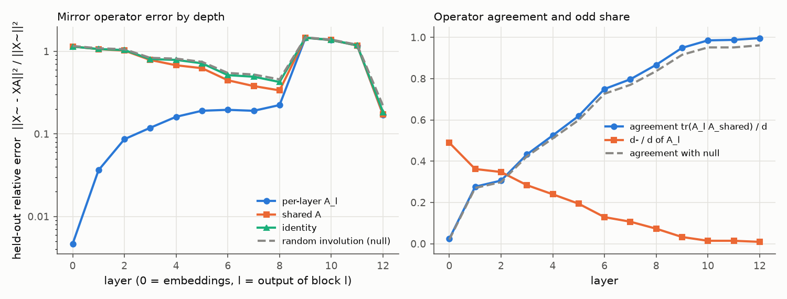
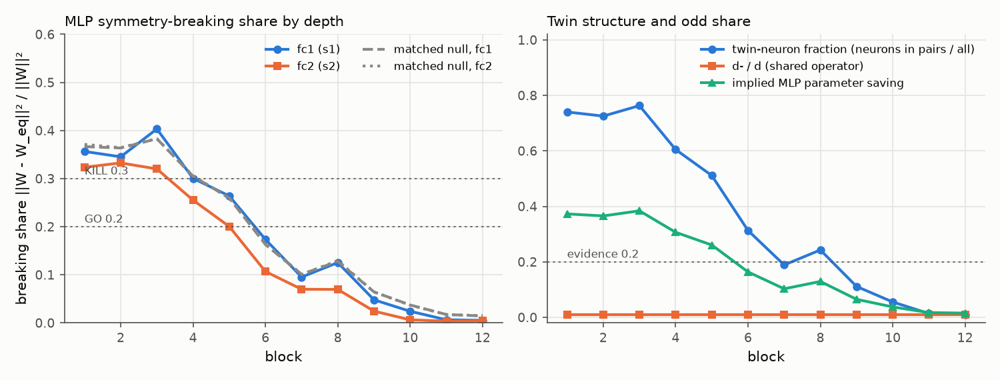

# E1 report: Mirror Surgery go/kill on dinov2_vitb14

**Outcome: KILL.** KILL cell in row(s) 1, 4, 5.

## Run

- Date: 2026-11-07 16:38:06; git commit `c74827fa0a78ff41933bacef682d36bf7e23727c`; seed 0.
- Config: `configs/e1.yaml`; device NVIDIA A100-SXM4-80GB; torch 2.11.0+cu128.
- Data: fit 2000, held-out 1000, k-NN bank 39000, queries 8000 images (each with its mirror).
- Total time 28.1 min. Stages (s): load 2, sanity 1, fit_stats 20, fit_operators 5, heldout_errors 9, position_check 0, mlp_matching 160, breaking_share 1, surgery_knn 1486.

## Decision table (blocks 1 to 6)

| Row | Check | Value | GO if | KILL if | Cell |
|---|---|---|---|---|---|
| 1 | e(null) / e(A_shared), mean over layers; worst layer 1: 1.02 | 1.102 | >= 5 | < 3 | **KILL** |
| 2 | e(A_shared) / e(I), mean over layers; worst layer 1: 0.996 | 0.9376 | <= 0.5 | informative only | **INFO** |
| 3 | d- / d (shared operator) | 0.01042 | >= 0.2 | < 0.1: blocks GO, no KILL (PIVOT: little to save) | **KILL** |
| 4 | MLP breaking share, max(mean s1, mean s2) [s1 0.307, s2 0.256; matched null s1 0.307, s2 0.308; twin fraction 0.610, d-/d 0.010] | 0.3072 | <= 0.2, and d-/d >= 0.2 or twin fraction >= 0.2 | > 0.3 | **KILL** |
| 5 | Zero-shot surgery at k = 6: k-NN drop [original 78.21, surgery 14.10, SVD 72.45; margin over SVD -58.35] | 64.11 | drop <= 10 and margin >= 5 | no better than SVD (margin <= 0) | **KILL** |

Per-layer values behind rows 1 and 2 (layer l is the output of block l). Worst layer: row 1 layer 1, row 2 layer 1.

| Layer | e(null) / e(A_shared) | e(A_shared) / e(I) |
|---|---|---|
| 1 | 1.025 (worst) | 0.9962 (worst) |
| 2 | 1.039 | 0.9853 |
| 3 | 1.06 | 0.9761 |
| 4 | 1.203 | 0.8609 |
| 5 | 1.193 | 0.8726 |
| 6 | 1.226 | 0.8672 |

How blocks are combined: rows 1 and 2 use the mean over layers 1 to 6 of the relative held-out error e / ||X~||², then the ratio of those means. Row 4 averages s1 and s2 over blocks 1 to 6 and uses the larger; a low share counts as evidence only if d-/d is at least 0.2 or the mean twin-neuron fraction is at least 0.2. Row 5 uses surgery on the first 6 blocks. Outcome, in order: KILL if any KILL cell in rows 1, 4 or 5; GO if all rows are GO; PIVOT: structure but little to save, if d-/d is below the row 3 KILL limit; PIVOT if rows 1 to 4 are GO and the drop is above the GO limit; otherwise AMBER (the table gives no verdict).

## Residual stream: one mirror operator?

Shared operator fitted on summed C over layers 1 to 12: d = 768, d+ = 760, d- = 8 (d-/d = 0.010). Directions with no signal (assigned +1): 1. Errors are relative, e / ||X~||², on held-out images; the null is a random orthogonal involution with the same d+ (mean of 3 seeds).

| layer | d- (A_l) | tr(A_l A)/d | e(A_l) | e(A) | e(A, scale-normalised fit) | e(I) | e(null) | e(null)/e(A) |
|---|---|---|---|---|---|---|---|---|
| 0 | 376 | 0.024 | 0.004671 | 1.146 | 0.4084 | 1.141 | 1.162 | 1.01 |
| 1 | 278 | 0.276 | 0.03634 | 1.063 | 0.4194 | 1.067 | 1.089 | 1.02 |
| 2 | 267 | 0.306 | 0.08624 | 1.021 | 0.467 | 1.037 | 1.061 | 1.04 |
| 3 | 218 | 0.433 | 0.1187 | 0.7863 | 0.3331 | 0.8055 | 0.8337 | 1.06 |
| 4 | 184 | 0.525 | 0.1612 | 0.6783 | 0.3307 | 0.7879 | 0.8158 | 1.2 |
| 5 | 149 | 0.619 | 0.1907 | 0.6253 | 0.3452 | 0.7166 | 0.7459 | 1.19 |
| 6 | 99 | 0.750 | 0.1956 | 0.4463 | 0.3166 | 0.5146 | 0.5471 | 1.23 |
| 7 | 82 | 0.797 | 0.1905 | 0.3795 | 0.3176 | 0.4931 | 0.5239 | 1.38 |
| 8 | 56 | 0.867 | 0.2236 | 0.3365 | 0.3809 | 0.4254 | 0.4576 | 1.36 |
| 9 | 25 | 0.949 | 1.46 | 1.464 | 1.474 | 1.467 | 1.478 | 1.01 |
| 10 | 11 | 0.985 | 1.367 | 1.37 | 1.399 | 1.375 | 1.388 | 1.01 |
| 11 | 11 | 0.988 | 1.177 | 1.179 | 1.251 | 1.186 | 1.203 | 1.02 |
| 12 | 7 | 0.996 | 0.1706 | 0.1717 | 0.4827 | 0.1831 | 0.219 | 1.27 |

## Position embedding

||mirror(P) - P A|| / ||P|| on the 16 x 16 patch grid (P channel-centred like the tokens; the second column also removes the mean over positions).

| Operator | channel-centred | also grid-centred |
|---|---|---|
| A_shared | 0.8091 | 0.845 |
| A_0 (layer 0) | 0.2561 | 0.2449 |
| identity | 0.967 | 1.014 |
| null | 0.9809 | 1.026 |

Layer 0 held-out error with the shared operator: e(A) = 1.146 (e(A_0) = 0.004671, e(I) = 1.141).

## MLP twins and breaking share

Neuron involution per block from the mirrored-versus-original fc1 correlations; breaking share of the folded weights against the shared operator. Matched null (mean of 3 seeds): a random involution with the same d+ and d- as the shared operator and, per block, a random pairing with the same numbers of pairs and self-twins as the fitted one. If the fitted structure is nearly trivial (few odd features, few pairs), the matched null is nearly trivial too and its share is also low; a low share then is not evidence. Twin fraction = neurons in pairs / all neurons. Evidence = d-/d at least 0.2 or twin fraction at least 0.2.

| block | pairs | self-twins | twin fraction | d-/d | mean corr (pairs) | mean corr (self) | s1 | s1 matched null | s2 | s2 matched null | evidence | implied saving | SVD rank |
|---|---|---|---|---|---|---|---|---|---|---|---|---|---|
| 1 | 1137 | 798 | 0.740 | 0.010 | 0.773 | 0.828 | 0.356 | 0.367 | 0.324 | 0.371 | yes | 0.373 | 385 |
| 2 | 1114 | 844 | 0.725 | 0.010 | 0.752 | 0.833 | 0.345 | 0.364 | 0.333 | 0.364 | yes | 0.365 | 389 |
| 3 | 1172 | 728 | 0.763 | 0.010 | 0.649 | 0.777 | 0.403 | 0.383 | 0.320 | 0.383 | yes | 0.384 | 378 |
| 4 | 929 | 1214 | 0.605 | 0.010 | 0.658 | 0.808 | 0.300 | 0.305 | 0.255 | 0.306 | yes | 0.307 | 426 |
| 5 | 785 | 1502 | 0.511 | 0.010 | 0.623 | 0.848 | 0.264 | 0.260 | 0.200 | 0.260 | yes | 0.261 | 454 |
| 6 | 481 | 2110 | 0.313 | 0.010 | 0.652 | 0.899 | 0.173 | 0.163 | 0.107 | 0.166 | yes | 0.164 | 513 |
| 7 | 290 | 2492 | 0.189 | 0.010 | 0.691 | 0.897 | 0.095 | 0.101 | 0.070 | 0.101 | no | 0.103 | 551 |
| 8 | 373 | 2326 | 0.243 | 0.010 | 0.734 | 0.922 | 0.125 | 0.128 | 0.070 | 0.129 | yes | 0.129 | 534 |
| 9 | 171 | 2730 | 0.111 | 0.010 | 0.779 | 0.922 | 0.048 | 0.064 | 0.024 | 0.064 | no | 0.065 | 574 |
| 10 | 85 | 2902 | 0.055 | 0.010 | 0.811 | 0.921 | 0.024 | 0.037 | 0.006 | 0.037 | no | 0.038 | 591 |
| 11 | 21 | 3030 | 0.014 | 0.010 | 0.756 | 0.916 | 0.006 | 0.017 | 0.004 | 0.017 | no | 0.017 | 603 |
| 12 | 15 | 3042 | 0.010 | 0.010 | 0.776 | 0.949 | 0.005 | 0.014 | 0.005 | 0.015 | no | 0.015 | 605 |

## Zero-shot surgery (k-NN, k = 20, T = 0.07)

Surgery replaces the MLPs of the first k blocks by their nearest mirror-equivariant weights. SVD keeps the same number of parameters as a rank-r factorisation. Random uses the null operator and pairing. Top-1 and flip consistency are in percent.

| k | variant | top-1 | drop (points) | flip consistency | MLP params kept (first k blocks) |
|---|---|---|---|---|---|
| 0 | original | 78.21 | 0.00 | 96.58 | 1.000 |
| 3 | surgery | 62.99 | 15.23 | 80.63 | 0.626 |
| 3 | svd | 76.93 | 1.29 | 94.58 | 0.625 |
| 3 | random | 68.59 | 9.62 | 85.90 | 0.626 |
| 6 | surgery | 14.10 | 64.11 | 34.26 | 0.691 |
| 6 | svd | 72.45 | 5.76 | 89.43 | 0.690 |
| 6 | random | 36.83 | 41.39 | 54.40 | 0.691 |
| 9 | surgery | 11.28 | 66.94 | 27.08 | 0.761 |
| 9 | svd | 55.80 | 22.41 | 71.70 | 0.760 |
| 9 | random | 22.76 | 55.45 | 38.28 | 0.761 |

## Sanity checks in this run

- Folding (block 0, one fit batch): max abs difference 6.68e-06.
- Identity surgery on all blocks (A = I, P = I), CLS features of one batch: max abs difference 2.81e-05.

All numbers come from `scripts/run_e1.py` with the config, seed and commit above; per-layer and per-block values are in `results/e1_layers.csv`, `results/e1_mlp.csv` and `results/e1_surgery.csv`.
