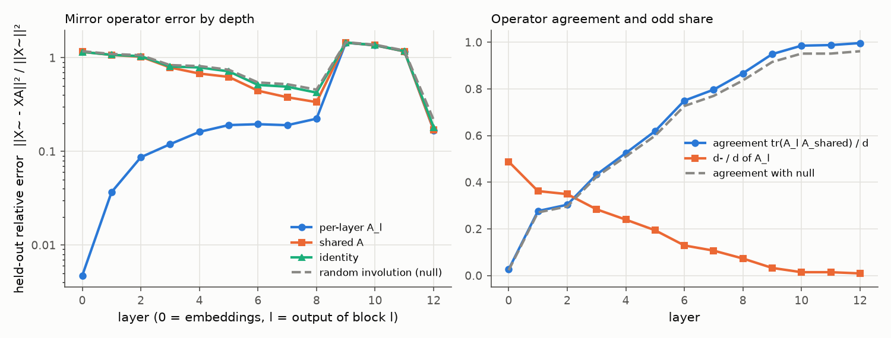
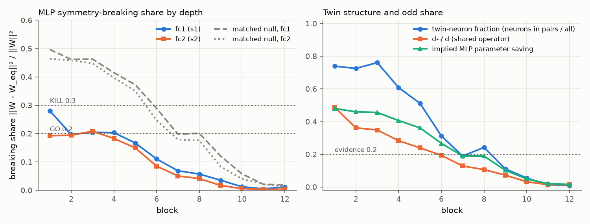

# E1 report: Mirror Surgery go/kill on dinov2_vitb14

**Outcome: GO.** Every check is in its GO cell.

## Run

- Date: 2026-11-07 19:09:56; git commit `cdcaa6e2453be07f0653c5c8ffeaa59646627773`; seed 0.
- Config: `configs/e1b_perlayer_b14.yaml`; device NVIDIA A100-SXM4-80GB; torch 2.11.0+cu128.
- Operator under test: one operator per layer (block b: fc1 against the operator of its input layer, fc2 against its output layer; nulls and SVD ranks matched per layer). Data split: shuffled within class, seed 1.
- Data: fit 2000, held-out 1000, k-NN bank 39000, queries 8000 images (each with its mirror).
- Total time 99.9 min. Stages (s): load 3, sanity 1, fit_stats 70, fit_operators 95, heldout_errors 31, position_check 0, mlp_matching 193, breaking_share 3, surgery_knn 5593.

## Decision table (blocks 1 to 6)

| Row | Check | Value | GO if | KILL if | Cell |
|---|---|---|---|---|---|
| 1 | e(null) / e(A_l (per layer)), mean over layers; worst layer 6: 4.55 | 10.57 | >= 5 | < 3 | **GO** |
| 2 | e(A_l (per layer)) / e(I), mean over layers; worst layer 6: 0.381 | 0.1601 | <= 0.5 | informative only | **GO** |
| 3 | d- / d (mean of per-layer A_l over layers 1 to 6) | 0.2595 | >= 0.2 | < 0.1: blocks GO, no KILL (PIVOT: little to save) | **GO** |
| 4 | MLP breaking share, max(mean s1, mean s2) [s1 0.194, s2 0.169; matched null s1 0.416, s2 0.394; twin fraction 0.610, d-/d 0.260] | 0.1939 | <= 0.2, and d-/d >= 0.2 or twin fraction >= 0.2 | > 0.3 | **GO** |
| 5 | Zero-shot surgery at k = 6: k-NN drop [original 77.35, surgery 73.73, SVD 64.41; margin over SVD 9.31] | 3.625 | drop <= 10 and margin >= 5 | no better than SVD (margin <= 0) | **GO** |

Per-layer values behind rows 1 and 2 (layer l is the output of block l). Worst layer: row 1 layer 6, row 2 layer 6.

| Layer | e(null) / e(A_l) | e(A_l) / e(I) |
|---|---|---|
| 1 | 47.15 | 0.03417 |
| 2 | 19.6 | 0.08325 |
| 3 | 12.3 | 0.1481 |
| 4 | 8.458 | 0.2052 |
| 5 | 6.285 | 0.2666 |
| 6 | 4.554 (worst) | 0.381 (worst) |

How blocks are combined: rows 1 and 2 use the mean over layers 1 to 6 of the relative held-out error e / ||X~||², then the ratio of those means. Row 4 averages s1 and s2 over blocks 1 to 6 and uses the larger; a low share counts as evidence only if d-/d is at least 0.2 or the mean twin-neuron fraction is at least 0.2. Row 5 uses surgery on the first 6 blocks. Outcome, in order: KILL if any KILL cell in rows 1, 4 or 5; GO if all rows are GO; PIVOT: structure but little to save, if d-/d is below the row 3 KILL limit; PIVOT if rows 1 to 4 are GO and the drop is above the GO limit; otherwise AMBER (the table gives no verdict).

## Residual stream: one mirror operator?

Shared operator fitted on summed C over layers 1 to 12: d = 768, d+ = 760, d- = 8 (d-/d = 0.010). Directions with no signal (assigned +1): 1. Errors are relative, e / ||X~||², on held-out images; the null is a random orthogonal involution with the same d+ (mean of 3 seeds).

| layer | d- (A_l) | tr(A_l A)/d | e(A_l) | e(A) | e(A, scale-normalised fit) | e(I) | e(null) | e(null)/e(A) |
|---|---|---|---|---|---|---|---|---|
| 0 | 375 | 0.027 | 0.004723 | 1.158 | 0.4235 | 1.154 | 1.173 | 1.01 |
| 1 | 278 | 0.276 | 0.03672 | 1.071 | 0.4297 | 1.075 | 1.097 | 1.02 |
| 2 | 268 | 0.303 | 0.08659 | 1.025 | 0.4717 | 1.04 | 1.065 | 1.04 |
| 3 | 218 | 0.433 | 0.1194 | 0.787 | 0.3321 | 0.8058 | 0.8341 | 1.06 |
| 4 | 184 | 0.525 | 0.1616 | 0.6778 | 0.3302 | 0.7873 | 0.8153 | 1.2 |
| 5 | 149 | 0.619 | 0.1909 | 0.6248 | 0.3444 | 0.716 | 0.7453 | 1.19 |
| 6 | 99 | 0.750 | 0.1952 | 0.4444 | 0.3152 | 0.5123 | 0.5448 | 1.23 |
| 7 | 82 | 0.797 | 0.1905 | 0.3785 | 0.3164 | 0.4909 | 0.5217 | 1.38 |
| 8 | 56 | 0.867 | 0.2234 | 0.336 | 0.3793 | 0.4241 | 0.4564 | 1.36 |
| 9 | 25 | 0.949 | 1.447 | 1.451 | 1.461 | 1.454 | 1.465 | 1.01 |
| 10 | 11 | 0.985 | 1.357 | 1.359 | 1.388 | 1.365 | 1.378 | 1.01 |
| 11 | 11 | 0.988 | 1.168 | 1.171 | 1.242 | 1.178 | 1.195 | 1.02 |
| 12 | 7 | 0.996 | 0.1681 | 0.1692 | 0.4816 | 0.1807 | 0.2164 | 1.28 |

## Position embedding

||mirror(P) - P A|| / ||P|| on the 16 x 16 patch grid (P channel-centred like the tokens; the second column also removes the mean over positions).

| Operator | channel-centred | also grid-centred |
|---|---|---|
| A_shared | 0.8097 | 0.8455 |
| A_0 (layer 0) | 0.2559 | 0.2448 |
| identity | 0.967 | 1.014 |
| null | 0.9809 | 1.026 |

Layer 0 held-out error with the shared operator: e(A) = 1.158 (e(A_0) = 0.004723, e(I) = 1.154).

## MLP twins and breaking share

Neuron involution per block from the mirrored-versus-original fc1 correlations; breaking share of the folded weights against each block's input-layer operator (fc1) and output-layer operator (fc2). Matched null (mean of 3 seeds): a random involution with the same d+ and d- as each layer's operator and, per block, a random pairing with the same numbers of pairs and self-twins as the fitted one. d-/d is that of the block's input-layer operator. If the fitted structure is nearly trivial (few odd features, few pairs), the matched null is nearly trivial too and its share is also low; a low share then is not evidence. Twin fraction = neurons in pairs / all neurons. Evidence = d-/d at least 0.2 or twin fraction at least 0.2.

| block | pairs | self-twins | twin fraction | d-/d | mean corr (pairs) | mean corr (self) | s1 | s1 matched null | s2 | s2 matched null | evidence | implied saving | SVD rank |
|---|---|---|---|---|---|---|---|---|---|---|---|---|---|
| 1 | 1136 | 800 | 0.740 | 0.488 | 0.772 | 0.828 | 0.281 | 0.497 | 0.192 | 0.464 | yes | 0.481 | 309 |
| 2 | 1114 | 844 | 0.725 | 0.362 | 0.751 | 0.835 | 0.197 | 0.462 | 0.194 | 0.458 | yes | 0.460 | 330 |
| 3 | 1169 | 734 | 0.761 | 0.349 | 0.650 | 0.772 | 0.205 | 0.463 | 0.209 | 0.448 | yes | 0.456 | 329 |
| 4 | 934 | 1204 | 0.608 | 0.284 | 0.656 | 0.813 | 0.204 | 0.415 | 0.183 | 0.397 | yes | 0.407 | 359 |
| 5 | 787 | 1498 | 0.512 | 0.240 | 0.622 | 0.851 | 0.167 | 0.372 | 0.150 | 0.350 | yes | 0.362 | 385 |
| 6 | 481 | 2110 | 0.313 | 0.194 | 0.652 | 0.899 | 0.111 | 0.289 | 0.086 | 0.247 | yes | 0.267 | 436 |
| 7 | 291 | 2490 | 0.189 | 0.129 | 0.690 | 0.898 | 0.069 | 0.198 | 0.051 | 0.179 | no | 0.190 | 492 |
| 8 | 373 | 2326 | 0.243 | 0.107 | 0.733 | 0.921 | 0.057 | 0.201 | 0.041 | 0.176 | yes | 0.189 | 490 |
| 9 | 171 | 2730 | 0.111 | 0.073 | 0.779 | 0.922 | 0.036 | 0.121 | 0.017 | 0.084 | no | 0.103 | 540 |
| 10 | 85 | 2902 | 0.055 | 0.033 | 0.811 | 0.920 | 0.012 | 0.058 | 0.006 | 0.040 | no | 0.050 | 578 |
| 11 | 21 | 3030 | 0.014 | 0.014 | 0.755 | 0.915 | 0.005 | 0.021 | 0.003 | 0.021 | no | 0.021 | 601 |
| 12 | 15 | 3042 | 0.010 | 0.014 | 0.777 | 0.949 | 0.012 | 0.019 | 0.004 | 0.014 | no | 0.016 | 602 |

## Zero-shot surgery (k-NN, k = 20, T = 0.07)

Surgery replaces the MLPs of the first k blocks by their nearest mirror-equivariant weights. SVD keeps the same number of parameters as a rank-r factorisation. Random uses the null operator and pairing. Top-1 and flip consistency are in percent.

| k | variant | top-1 | drop (points) | flip consistency | MLP params kept (first k blocks) |
|---|---|---|---|---|---|
| 0 | original | 77.35 | 0.00 | 96.09 | 1.000 |
| 3 | surgery | 75.74 | 1.61 | 92.61 | 0.534 |
| 3 | svd | 76.06 | 1.29 | 93.38 | 0.534 |
| 3 | random | 6.58 | 70.78 | 18.03 | 0.534 |
| 6 | surgery | 73.73 | 3.62 | 89.70 | 0.595 |
| 6 | svd | 64.41 | 12.94 | 82.90 | 0.594 |
| 6 | random | 3.78 | 73.58 | 18.71 | 0.595 |
| 9 | surgery | 71.69 | 5.66 | 87.05 | 0.676 |
| 9 | svd | 34.80 | 42.55 | 49.04 | 0.675 |
| 9 | random | 3.35 | 74.00 | 15.00 | 0.676 |

## Sanity checks in this run

- Folding (block 0, one fit batch): max abs difference 8.82e-06.
- Identity surgery on all blocks (A = I, P = I), CLS features of one batch: max abs difference 2.41e-05.

All numbers come from `scripts/run_e1.py` with the config, seed and commit above; per-layer and per-block values are in `results/e1_layers.csv`, `results/e1_mlp.csv` and `results/e1_surgery.csv`.
