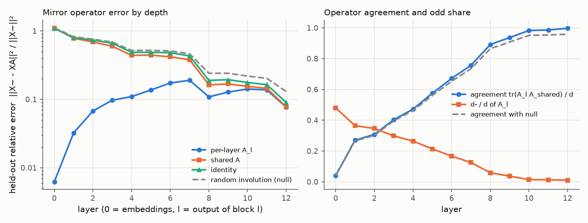
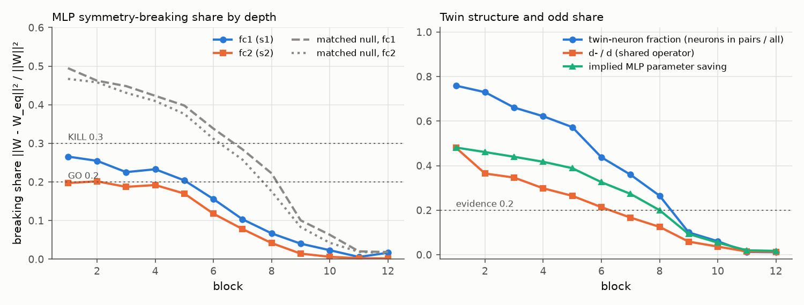

# E1 report: Mirror Surgery go/kill on dinov2_vitb14_reg

**Outcome: AMBER.** No rule fires: row(s) 4 not GO and no KILL cell in rows 1, 4, 5; needs a human decision.

## Run

- Date: 2026-11-07 21:43:28; git commit `894d462b6c06e19ebd55bd661fe2355bb506cd0c`; seed 0.
- Config: `configs/e1b_perlayer_b14reg.yaml`; device NVIDIA A100-SXM4-80GB; torch 2.11.0+cu128.
- Operator under test: one operator per layer (block b: fc1 against the operator of its input layer, fc2 against its output layer; nulls and SVD ranks matched per layer). Data split: shuffled within class, seed 1.
- Data: fit 2000, held-out 1000, k-NN bank 39000, queries 8000 images (each with its mirror).
- Total time 99.9 min. Stages (s): load 5, sanity 1, fit_stats 76, fit_operators 138, heldout_errors 33, position_check 0, mlp_matching 243, breaking_share 3, surgery_knn 5488.

## Decision table (blocks 1 to 6)

| Row | Check | Value | GO if | KILL if | Cell |
|---|---|---|---|---|---|
| 1 | e(null) / e(A_l (per layer)), mean over layers; worst layer 6: 5.74 | 13.18 | >= 5 | < 3 | **GO** |
| 2 | e(A_l (per layer)) / e(I), mean over layers; worst layer 6: 0.361 | 0.169 | <= 0.5 | informative only | **GO** |
| 3 | d- / d (mean of per-layer A_l over layers 1 to 6) | 0.2756 | >= 0.2 | < 0.1: blocks GO, no KILL (PIVOT: little to save) | **GO** |
| 4 | MLP breaking share, max(mean s1, mean s2) [s1 0.223, s2 0.178; matched null s1 0.427, s2 0.409; twin fraction 0.630, d-/d 0.276] | 0.2231 | <= 0.2, and d-/d >= 0.2 or twin fraction >= 0.2 | > 0.3 | **AMBER** |
| 5 | Zero-shot surgery at k = 6: k-NN drop [original 78.11, surgery 76.34, SVD 8.08; margin over SVD 68.26] | 1.775 | drop <= 10 and margin >= 5 | no better than SVD (margin <= 0) | **GO** |

Per-layer values behind rows 1 and 2 (layer l is the output of block l). Worst layer: row 1 layer 6, row 2 layer 6.

| Layer | e(null) / e(A_l) | e(A_l) / e(I) |
|---|---|---|
| 1 | 51.55 | 0.04041 |
| 2 | 23.72 | 0.09202 |
| 3 | 15.07 | 0.1464 |
| 4 | 11.58 | 0.2253 |
| 5 | 8.277 | 0.2815 |
| 6 | 5.744 (worst) | 0.3608 (worst) |

How blocks are combined: rows 1 and 2 use the mean over layers 1 to 6 of the relative held-out error e / ||X~||², then the ratio of those means. Row 4 averages s1 and s2 over blocks 1 to 6 and uses the larger; a low share counts as evidence only if d-/d is at least 0.2 or the mean twin-neuron fraction is at least 0.2. Row 5 uses surgery on the first 6 blocks. Outcome, in order: KILL if any KILL cell in rows 1, 4 or 5; GO if all rows are GO; PIVOT: structure but little to save, if d-/d is below the row 3 KILL limit; PIVOT if rows 1 to 4 are GO and the drop is above the GO limit; otherwise AMBER (the table gives no verdict).

## Residual stream: one mirror operator?

Shared operator fitted on summed C over layers 1 to 12: d = 768, d+ = 760, d- = 8 (d-/d = 0.010). Directions with no signal (assigned +1): 1. Errors are relative, e / ||X~||², on held-out images; the null is a random orthogonal involution with the same d+ (mean of 3 seeds).

| layer | d- (A_l) | tr(A_l A)/d | e(A_l) | e(A) | e(A, scale-normalised fit) | e(I) | e(null) | e(null)/e(A) |
|---|---|---|---|---|---|---|---|---|
| 0 | 369 | 0.041 | 0.006234 | 1.1 | 0.6554 | 1.091 | 1.111 | 1.01 |
| 1 | 280 | 0.270 | 0.0323 | 0.7826 | 0.3794 | 0.7994 | 0.8227 | 1.05 |
| 2 | 266 | 0.308 | 0.06761 | 0.6889 | 0.3098 | 0.7347 | 0.7581 | 1.1 |
| 3 | 229 | 0.403 | 0.09699 | 0.5986 | 0.2751 | 0.6626 | 0.6879 | 1.15 |
| 4 | 203 | 0.472 | 0.1099 | 0.4398 | 0.2495 | 0.4878 | 0.5196 | 1.18 |
| 5 | 164 | 0.575 | 0.1371 | 0.4443 | 0.2805 | 0.4869 | 0.5199 | 1.17 |
| 6 | 128 | 0.671 | 0.1736 | 0.4176 | 0.3023 | 0.4811 | 0.5118 | 1.23 |
| 7 | 96 | 0.757 | 0.1901 | 0.3803 | 0.3106 | 0.4314 | 0.4636 | 1.22 |
| 8 | 45 | 0.891 | 0.1087 | 0.1628 | 0.1692 | 0.1893 | 0.2409 | 1.48 |
| 9 | 28 | 0.937 | 0.1279 | 0.1684 | 0.2053 | 0.1939 | 0.2408 | 1.43 |
| 10 | 11 | 0.983 | 0.1418 | 0.1548 | 0.2431 | 0.1763 | 0.2189 | 1.41 |
| 11 | 10 | 0.986 | 0.1374 | 0.145 | 0.2442 | 0.1639 | 0.203 | 1.4 |
| 12 | 8 | 0.997 | 0.07684 | 0.07764 | 0.225 | 0.09011 | 0.13 | 1.67 |

## Position embedding

||mirror(P) - P A|| / ||P|| on the 16 x 16 patch grid (P channel-centred like the tokens; the second column also removes the mean over positions).

| Operator | channel-centred | also grid-centred |
|---|---|---|
| A_shared | 0.8513 | 0.8747 |
| A_0 (layer 0) | 0.2133 | 0.1857 |
| identity | 1.052 | 1.082 |
| null | 1.061 | 1.09 |

Layer 0 held-out error with the shared operator: e(A) = 1.1 (e(A_0) = 0.006234, e(I) = 1.091).

## MLP twins and breaking share

Neuron involution per block from the mirrored-versus-original fc1 correlations; breaking share of the folded weights against each block's input-layer operator (fc1) and output-layer operator (fc2). Matched null (mean of 3 seeds): a random involution with the same d+ and d- as each layer's operator and, per block, a random pairing with the same numbers of pairs and self-twins as the fitted one. d-/d is that of the block's input-layer operator. If the fitted structure is nearly trivial (few odd features, few pairs), the matched null is nearly trivial too and its share is also low; a low share then is not evidence. Twin fraction = neurons in pairs / all neurons. Evidence = d-/d at least 0.2 or twin fraction at least 0.2.

| block | pairs | self-twins | twin fraction | d-/d | mean corr (pairs) | mean corr (self) | s1 | s1 matched null | s2 | s2 matched null | evidence | implied saving | SVD rank |
|---|---|---|---|---|---|---|---|---|---|---|---|---|---|
| 1 | 1166 | 740 | 0.759 | 0.480 | 0.801 | 0.814 | 0.266 | 0.495 | 0.197 | 0.467 | yes | 0.481 | 310 |
| 2 | 1121 | 830 | 0.730 | 0.365 | 0.722 | 0.778 | 0.255 | 0.462 | 0.202 | 0.458 | yes | 0.461 | 329 |
| 3 | 1015 | 1042 | 0.661 | 0.346 | 0.680 | 0.798 | 0.225 | 0.448 | 0.187 | 0.431 | yes | 0.440 | 339 |
| 4 | 955 | 1162 | 0.622 | 0.298 | 0.632 | 0.781 | 0.233 | 0.423 | 0.192 | 0.410 | yes | 0.417 | 354 |
| 5 | 880 | 1312 | 0.573 | 0.264 | 0.622 | 0.800 | 0.204 | 0.398 | 0.170 | 0.376 | yes | 0.389 | 369 |
| 6 | 672 | 1728 | 0.438 | 0.214 | 0.663 | 0.856 | 0.156 | 0.338 | 0.118 | 0.312 | yes | 0.326 | 406 |
| 7 | 552 | 1968 | 0.359 | 0.167 | 0.701 | 0.897 | 0.103 | 0.284 | 0.078 | 0.258 | yes | 0.273 | 438 |
| 8 | 407 | 2258 | 0.265 | 0.125 | 0.768 | 0.927 | 0.067 | 0.222 | 0.042 | 0.176 | yes | 0.200 | 476 |
| 9 | 154 | 2764 | 0.100 | 0.059 | 0.794 | 0.928 | 0.040 | 0.101 | 0.014 | 0.083 | no | 0.093 | 551 |
| 10 | 93 | 2886 | 0.061 | 0.036 | 0.823 | 0.936 | 0.023 | 0.063 | 0.006 | 0.042 | no | 0.054 | 574 |
| 11 | 19 | 3034 | 0.012 | 0.014 | 0.833 | 0.926 | 0.006 | 0.020 | 0.002 | 0.019 | no | 0.020 | 601 |
| 12 | 17 | 3038 | 0.011 | 0.013 | 0.841 | 0.957 | 0.016 | 0.018 | 0.002 | 0.016 | no | 0.017 | 603 |

## Zero-shot surgery (k-NN, k = 20, T = 0.07)

Surgery replaces the MLPs of the first k blocks by their nearest mirror-equivariant weights. SVD keeps the same number of parameters as a rank-r factorisation. Random uses the null operator and pairing. Top-1 and flip consistency are in percent.

| k | variant | top-1 | drop (points) | flip consistency | MLP params kept (first k blocks) |
|---|---|---|---|---|---|
| 0 | original | 78.11 | 0.00 | 96.38 | 1.000 |
| 3 | surgery | 77.35 | 0.76 | 94.54 | 0.539 |
| 3 | svd | 75.81 | 2.30 | 93.29 | 0.539 |
| 3 | random | 3.20 | 74.91 | 7.95 | 0.539 |
| 6 | surgery | 76.34 | 1.77 | 92.71 | 0.581 |
| 6 | svd | 8.08 | 70.04 | 46.06 | 0.581 |
| 6 | random | 3.31 | 74.80 | 16.66 | 0.581 |
| 9 | surgery | 75.79 | 2.32 | 90.40 | 0.658 |
| 9 | svd | 5.84 | 72.28 | 36.71 | 0.657 |
| 9 | random | 4.63 | 73.49 | 27.66 | 0.658 |

## Sanity checks in this run

- Folding (block 0, one fit batch): max abs difference 1.62e-05.
- Identity surgery on all blocks (A = I, P = I), CLS features of one batch: max abs difference 2.12e-05.

All numbers come from `scripts/run_e1.py` with the config, seed and commit above; per-layer and per-block values are in `results/e1_layers.csv`, `results/e1_mlp.csv` and `results/e1_surgery.csv`.
