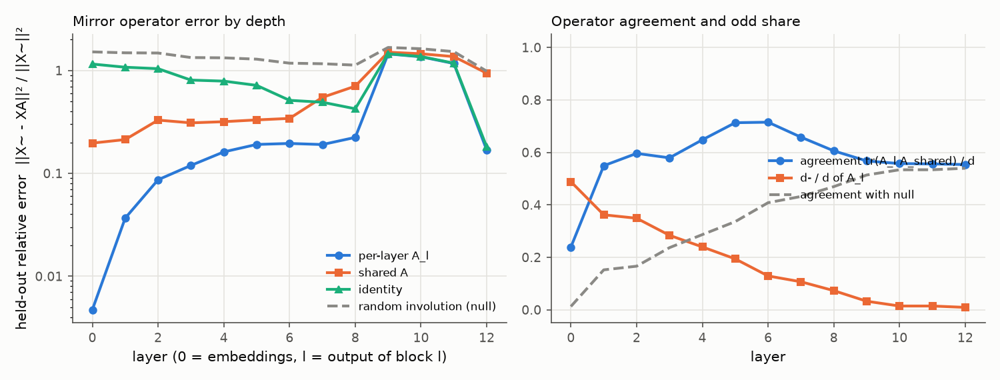
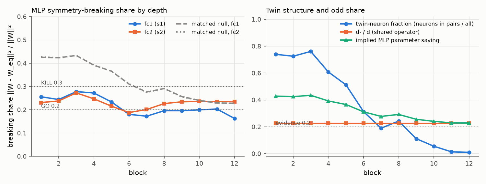

# E1 report: Mirror Surgery go/kill on dinov2_vitb14

**Outcome: AMBER.** No rule fires: row(s) 1, 4 not GO and no KILL cell in rows 1, 4, 5; needs a human decision.

## Run

- Date: 2026-11-07 22:34:07; git commit `894d462b6c06e19ebd55bd661fe2355bb506cd0c`; seed 0.
- Config: `configs/e1b_shared16_b14.yaml`; device NVIDIA A100-SXM4-80GB; torch 2.11.0+cu128.
- Operator under test: one shared operator for all layers. Data split: shuffled within class, seed 1.
- Data: fit 2000, held-out 1000, k-NN bank 39000, queries 8000 images (each with its mirror).
- Total time 50.5 min. Stages (s): load 3, sanity 1, fit_stats 25, fit_operators 127, heldout_errors 22, position_check 0, mlp_matching 234, breaking_share 2, surgery_knn 2612.

## Decision table (blocks 1 to 6)

| Row | Check | Value | GO if | KILL if | Cell |
|---|---|---|---|---|---|
| 1 | e(null) / e(A_shared), mean over layers; worst layer 6: 3.44 | 4.39 | >= 5 | < 3 | **AMBER** |
| 2 | e(A_shared) / e(I), mean over layers; worst layer 6: 0.667 | 0.3731 | <= 0.5 | informative only | **GO** |
| 3 | d- / d (shared operator) | 0.2253 | >= 0.2 | < 0.1: blocks GO, no KILL (PIVOT: little to save) | **GO** |
| 4 | MLP breaking share, max(mean s1, mean s2) [s1 0.244, s2 0.232; matched null s1 0.392, s2 0.392; twin fraction 0.610, d-/d 0.225] | 0.244 | <= 0.2, and d-/d >= 0.2 or twin fraction >= 0.2 | > 0.3 | **AMBER** |
| 5 | Zero-shot surgery at k = 6: k-NN drop [original 77.35, surgery 72.60, SVD 65.96; margin over SVD 6.64] | 4.75 | drop <= 10 and margin >= 5 | no better than SVD (margin <= 0) | **GO** |

Per-layer values behind rows 1 and 2 (layer l is the output of block l). Worst layer: row 1 layer 6, row 2 layer 6.

| Layer | e(null) / e(A_shared) | e(A_shared) / e(I) |
|---|---|---|
| 1 | 6.968 | 0.1981 |
| 2 | 4.486 | 0.3165 |
| 3 | 4.312 | 0.384 |
| 4 | 4.174 | 0.4035 |
| 5 | 3.893 | 0.4617 |
| 6 | 3.442 (worst) | 0.6672 (worst) |

How blocks are combined: rows 1 and 2 use the mean over layers 1 to 6 of the relative held-out error e / ||X~||², then the ratio of those means. Row 4 averages s1 and s2 over blocks 1 to 6 and uses the larger; a low share counts as evidence only if d-/d is at least 0.2 or the mean twin-neuron fraction is at least 0.2. Row 5 uses surgery on the first 6 blocks. Outcome, in order: KILL if any KILL cell in rows 1, 4 or 5; GO if all rows are GO; PIVOT: structure but little to save, if d-/d is below the row 3 KILL limit; PIVOT if rows 1 to 4 are GO and the drop is above the GO limit; otherwise AMBER (the table gives no verdict).

## Residual stream: one mirror operator?

Shared operator fitted on summed C over layers 1 to 6: d = 768, d+ = 595, d- = 173 (d-/d = 0.225). Directions with no signal (assigned +1): 1. Errors are relative, e / ||X~||², on held-out images; the null is a random orthogonal involution with the same d+ (mean of 3 seeds).

| layer | d- (A_l) | tr(A_l A)/d | e(A_l) | e(A) | e(A, scale-normalised fit) | e(I) | e(null) | e(null)/e(A) |
|---|---|---|---|---|---|---|---|---|
| 0 | 375 | 0.239 | 0.004723 | 0.1967 | 0.1732 | 1.154 | 1.515 | 7.7 |
| 1 | 278 | 0.549 | 0.03672 | 0.2129 | 0.1713 | 1.075 | 1.484 | 6.97 |
| 2 | 268 | 0.596 | 0.08659 | 0.3292 | 0.2474 | 1.04 | 1.477 | 4.49 |
| 3 | 218 | 0.579 | 0.1194 | 0.3094 | 0.2438 | 0.8058 | 1.334 | 4.31 |
| 4 | 184 | 0.648 | 0.1616 | 0.3177 | 0.2958 | 0.7873 | 1.326 | 4.17 |
| 5 | 149 | 0.713 | 0.1909 | 0.3305 | 0.3609 | 0.716 | 1.287 | 3.89 |
| 6 | 99 | 0.715 | 0.1952 | 0.3418 | 0.4385 | 0.5123 | 1.177 | 3.44 |
| 7 | 82 | 0.658 | 0.1905 | 0.5473 | 0.6532 | 0.4909 | 1.162 | 2.12 |
| 8 | 56 | 0.606 | 0.2234 | 0.7031 | 0.8156 | 0.4241 | 1.126 | 1.6 |
| 9 | 25 | 0.567 | 1.447 | 1.503 | 1.518 | 1.454 | 1.672 | 1.11 |
| 10 | 11 | 0.557 | 1.357 | 1.453 | 1.474 | 1.365 | 1.625 | 1.12 |
| 11 | 11 | 0.556 | 1.168 | 1.362 | 1.402 | 1.178 | 1.523 | 1.12 |
| 12 | 7 | 0.554 | 0.1681 | 0.9398 | 1.075 | 0.1807 | 0.9836 | 1.05 |

## Position embedding

||mirror(P) - P A|| / ||P|| on the 16 x 16 patch grid (P channel-centred like the tokens; the second column also removes the mean over positions).

| Operator | channel-centred | also grid-centred |
|---|---|---|
| A_shared | 0.5307 | 0.5456 |
| A_0 (layer 0) | 0.2559 | 0.2448 |
| identity | 0.967 | 1.014 |
| null | 1.195 | 1.221 |

Layer 0 held-out error with the shared operator: e(A) = 0.1967 (e(A_0) = 0.004723, e(I) = 1.154).

## MLP twins and breaking share

Neuron involution per block from the mirrored-versus-original fc1 correlations; breaking share of the folded weights against the shared operator. Matched null (mean of 3 seeds): a random involution with the same d+ and d- as the shared operator and, per block, a random pairing with the same numbers of pairs and self-twins as the fitted one. d-/d is that of the block's input-layer operator. If the fitted structure is nearly trivial (few odd features, few pairs), the matched null is nearly trivial too and its share is also low; a low share then is not evidence. Twin fraction = neurons in pairs / all neurons. Evidence = d-/d at least 0.2 or twin fraction at least 0.2.

| block | pairs | self-twins | twin fraction | d-/d | mean corr (pairs) | mean corr (self) | s1 | s1 matched null | s2 | s2 matched null | evidence | implied saving | SVD rank |
|---|---|---|---|---|---|---|---|---|---|---|---|---|---|
| 1 | 1136 | 800 | 0.740 | 0.225 | 0.772 | 0.828 | 0.256 | 0.425 | 0.231 | 0.427 | yes | 0.428 | 351 |
| 2 | 1114 | 844 | 0.725 | 0.225 | 0.751 | 0.835 | 0.244 | 0.423 | 0.238 | 0.424 | yes | 0.425 | 353 |
| 3 | 1169 | 734 | 0.761 | 0.225 | 0.650 | 0.772 | 0.278 | 0.433 | 0.273 | 0.434 | yes | 0.434 | 347 |
| 4 | 934 | 1204 | 0.608 | 0.225 | 0.656 | 0.813 | 0.272 | 0.391 | 0.247 | 0.392 | yes | 0.392 | 373 |
| 5 | 787 | 1498 | 0.512 | 0.225 | 0.622 | 0.851 | 0.234 | 0.366 | 0.216 | 0.365 | yes | 0.366 | 389 |
| 6 | 481 | 2110 | 0.313 | 0.225 | 0.652 | 0.899 | 0.180 | 0.310 | 0.188 | 0.312 | yes | 0.311 | 423 |
| 7 | 291 | 2490 | 0.189 | 0.225 | 0.690 | 0.898 | 0.172 | 0.276 | 0.201 | 0.275 | yes | 0.277 | 444 |
| 8 | 373 | 2326 | 0.243 | 0.225 | 0.733 | 0.921 | 0.196 | 0.291 | 0.227 | 0.291 | yes | 0.292 | 435 |
| 9 | 171 | 2730 | 0.111 | 0.225 | 0.779 | 0.922 | 0.196 | 0.257 | 0.234 | 0.255 | yes | 0.256 | 457 |
| 10 | 85 | 2902 | 0.055 | 0.225 | 0.811 | 0.920 | 0.200 | 0.240 | 0.236 | 0.240 | yes | 0.240 | 466 |
| 11 | 21 | 3030 | 0.014 | 0.225 | 0.755 | 0.915 | 0.203 | 0.229 | 0.235 | 0.229 | yes | 0.229 | 473 |
| 12 | 15 | 3042 | 0.010 | 0.225 | 0.777 | 0.949 | 0.163 | 0.228 | 0.234 | 0.227 | yes | 0.228 | 474 |

## Zero-shot surgery (k-NN, k = 20, T = 0.07)

Surgery replaces the MLPs of the first k blocks by their nearest mirror-equivariant weights. SVD keeps the same number of parameters as a rank-r factorisation. Random uses the null operator and pairing. Top-1 and flip consistency are in percent.

| k | variant | top-1 | drop (points) | flip consistency | MLP params kept (first k blocks) |
|---|---|---|---|---|---|
| 0 | original | 77.35 | 0.00 | 96.09 | 1.000 |
| 3 | surgery | 76.30 | 1.05 | 92.36 | 0.571 |
| 3 | svd | 76.56 | 0.79 | 93.61 | 0.570 |
| 3 | random | 18.68 | 58.68 | 31.54 | 0.571 |
| 6 | surgery | 72.60 | 4.75 | 88.60 | 0.607 |
| 6 | svd | 65.96 | 11.39 | 84.14 | 0.607 |
| 6 | random | 4.16 | 73.19 | 13.58 | 0.607 |
| 9 | surgery | 46.59 | 30.76 | 59.98 | 0.646 |
| 9 | svd | 26.79 | 50.56 | 39.46 | 0.646 |
| 9 | random | 3.81 | 73.54 | 10.65 | 0.646 |

## Sanity checks in this run

- Folding (block 0, one fit batch): max abs difference 8.82e-06.
- Identity surgery on all blocks (A = I, P = I), CLS features of one batch: max abs difference 2.41e-05.

All numbers come from `scripts/run_e1.py` with the config, seed and commit above; per-layer and per-block values are in `results/e1_layers.csv`, `results/e1_mlp.csv` and `results/e1_surgery.csv`.
