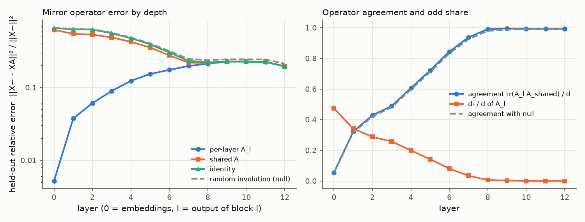
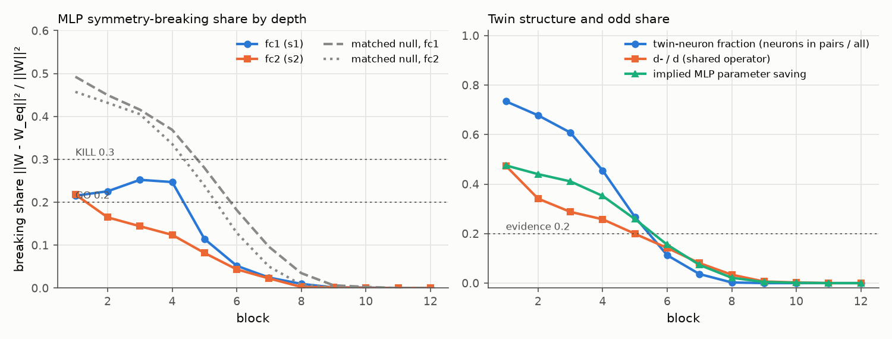

# E1 report: Mirror Surgery go/kill on deit3_b16

**Outcome: AMBER.** No rule fires: row(s) 5 not GO and no KILL cell in rows 1, 4, 5; needs a human decision.

## Run

- Date: 2026-11-08 10:05:31; git commit `98faa6454f6447b57958487eea0fd57a44676947`; seed 0.
- Config: `configs/g_deit3_b16.yaml`; device NVIDIA A100-SXM4-80GB; torch 2.11.0+cu128.
- Operator under test: one operator per layer (block b: fc1 against the operator of its input layer, fc2 against its output layer; nulls and SVD ranks matched per layer). Data split: cached order of appearance.
- Data: fit 2000, held-out 1000, k-NN bank 100000, queries 50000 images (each with its mirror); protocol v2: operators fitted on ImageNet train (fit seed 0), held-out errors and k-NN queries on validation, k-NN bank from train, k-NN features in bf16.
- Total time 76.1 min. Stages (s): load 12, sanity 1, fit_stats 68, fit_operators 1506, heldout_errors 44, position_check 2, mlp_matching 787, breaking_share 6, surgery_knn 2110.

## Decision table (blocks 1 to 6)

| Row | Check | Value | GO if | KILL if | Cell |
|---|---|---|---|---|---|
| 1 | e(null) / e(A_l (per layer)), mean over layers; worst layer 6: 3.39 | 10.66 | >= 5 | < 3 | **GO** |
| 2 | e(A_l (per layer)) / e(I), mean over layers; worst layer 6: 0.577 | 0.2145 | <= 0.5 | informative only | **GO** |
| 3 | d- / d (mean of per-layer A_l over layers 1 to 6) | 0.2181 | >= 0.2 | < 0.1: blocks GO, no KILL (PIVOT: little to save) | **GO** |
| 4 | MLP breaking share, max(mean s1, mean s2) [s1 0.184, s2 0.129; matched null s1 0.365, s2 0.333; twin fraction 0.476, d-/d 0.218] | 0.1844 | <= 0.2, and d-/d >= 0.2 or twin fraction >= 0.2 | > 0.3 | **GO** |
| 5 | Zero-shot surgery at k = 6: k-NN drop [original 82.95, surgery 81.55, SVD 80.67; margin over SVD 0.88] | 1.406 | drop <= 10 and margin >= 5 | no better than SVD (margin <= 0) | **AMBER** |

Per-layer values behind rows 1 and 2 (layer l is the output of block l). Worst layer: row 1 layer 6, row 2 layer 6.

| Layer | e(null) / e(A_l) | e(A_l) / e(I) |
|---|---|---|
| 1 | 41.92 | 0.05948 |
| 2 | 23.35 | 0.0978 |
| 3 | 14.43 | 0.1612 |
| 4 | 8.856 | 0.2596 |
| 5 | 5.492 | 0.3916 |
| 6 | 3.391 (worst) | 0.5769 (worst) |

How blocks are combined: rows 1 and 2 use the mean over layers 1 to 6 of the relative held-out error e / ||X~||², then the ratio of those means. Row 4 averages s1 and s2 over blocks 1 to 6 and uses the larger; a low share counts as evidence only if d-/d is at least 0.2 or the mean twin-neuron fraction is at least 0.2. Row 5 uses surgery on the first 6 blocks. Outcome, in order: KILL if any KILL cell in rows 1, 4 or 5; GO if all rows are GO; PIVOT: structure but little to save, if d-/d is below the row 3 KILL limit; PIVOT if rows 1 to 4 are GO and the drop is above the GO limit; otherwise AMBER (the table gives no verdict).

## Residual stream: one mirror operator?

Shared operator fitted on summed C over layers 1 to 12: d = 768, d+ = 765, d- = 3 (d-/d = 0.004). Directions with no signal (assigned +1): 1. Errors are relative, e / ||X~||², on held-out images; the null is a random orthogonal involution with the same d+ (mean of 3 seeds).

| layer | d- (A_l) | tr(A_l A)/d | e(A_l) | e(A) | e(A, scale-normalised fit) | e(I) | e(null) | e(null)/e(A) |
|---|---|---|---|---|---|---|---|---|
| 0 | 364 | 0.055 | 0.005204 | 0.6182 | 0.1745 | 0.6549 | 0.6629 | 1.07 |
| 1 | 262 | 0.322 | 0.03759 | 0.5475 | 0.1401 | 0.632 | 0.6387 | 1.17 |
| 2 | 221 | 0.429 | 0.06107 | 0.5325 | 0.165 | 0.6244 | 0.6323 | 1.19 |
| 3 | 198 | 0.489 | 0.0897 | 0.4876 | 0.1982 | 0.5564 | 0.5659 | 1.16 |
| 4 | 153 | 0.606 | 0.1236 | 0.4249 | 0.2177 | 0.476 | 0.4864 | 1.14 |
| 5 | 109 | 0.721 | 0.1535 | 0.354 | 0.2198 | 0.3921 | 0.4037 | 1.14 |
| 6 | 62 | 0.844 | 0.1746 | 0.2764 | 0.2137 | 0.3027 | 0.316 | 1.14 |
| 7 | 26 | 0.937 | 0.1976 | 0.2199 | 0.2328 | 0.2328 | 0.2478 | 1.13 |
| 8 | 5 | 0.991 | 0.2125 | 0.2165 | 0.2713 | 0.2214 | 0.2375 | 1.1 |
| 9 | 2 | 0.995 | 0.2267 | 0.2278 | 0.3016 | 0.2276 | 0.2437 | 1.07 |
| 10 | 0 | 0.992 | 0.2268 | 0.2287 | 0.3013 | 0.2268 | 0.2439 | 1.07 |
| 11 | 0 | 0.992 | 0.2245 | 0.2262 | 0.2758 | 0.2245 | 0.2429 | 1.07 |
| 12 | 0 | 0.992 | 0.1948 | 0.1965 | 0.2395 | 0.1948 | 0.2125 | 1.08 |

## Position embedding

||mirror(P) - P A|| / ||P|| on the 14 x 14 patch grid (P channel-centred like the tokens; the second column also removes the mean over positions).

| Operator | channel-centred | also grid-centred |
|---|---|---|
| A_shared | 0.8358 | 0.8531 |
| A_0 (layer 0) | 0.1642 | 0.08859 |
| identity | 0.9867 | 1.007 |
| null | 0.9888 | 1.009 |

Layer 0 held-out error with the shared operator: e(A) = 0.6182 (e(A_0) = 0.005204, e(I) = 0.6549).

## MLP twins and breaking share

Neuron involution per block from the mirrored-versus-original fc1 correlations; breaking share of the folded weights against each block's input-layer operator (fc1) and output-layer operator (fc2). Matched null (mean of 3 seeds): a random involution with the same d+ and d- as each layer's operator and, per block, a random pairing with the same numbers of pairs and self-twins as the fitted one. d-/d is that of the block's input-layer operator. If the fitted structure is nearly trivial (few odd features, few pairs), the matched null is nearly trivial too and its share is also low; a low share then is not evidence. Twin fraction = neurons in pairs / all neurons. Evidence = d-/d at least 0.2 or twin fraction at least 0.2.

| block | pairs | self-twins | twin fraction | d-/d | mean corr (pairs) | mean corr (self) | s1 | s1 matched null | s2 | s2 matched null | evidence | implied saving | SVD rank |
|---|---|---|---|---|---|---|---|---|---|---|---|---|---|
| 1 | 1128 | 816 | 0.734 | 0.474 | 0.733 | 0.744 | 0.215 | 0.493 | 0.218 | 0.457 | yes | 0.475 | 311 |
| 2 | 1041 | 990 | 0.678 | 0.341 | 0.700 | 0.808 | 0.226 | 0.450 | 0.165 | 0.432 | yes | 0.440 | 338 |
| 3 | 934 | 1204 | 0.608 | 0.288 | 0.660 | 0.844 | 0.252 | 0.416 | 0.144 | 0.405 | yes | 0.411 | 358 |
| 4 | 699 | 1674 | 0.455 | 0.258 | 0.642 | 0.873 | 0.247 | 0.369 | 0.124 | 0.336 | yes | 0.352 | 388 |
| 5 | 410 | 2252 | 0.267 | 0.199 | 0.660 | 0.911 | 0.114 | 0.280 | 0.082 | 0.238 | yes | 0.259 | 442 |
| 6 | 173 | 2726 | 0.113 | 0.142 | 0.718 | 0.923 | 0.052 | 0.182 | 0.044 | 0.129 | no | 0.155 | 502 |
| 7 | 56 | 2960 | 0.036 | 0.081 | 0.705 | 0.921 | 0.024 | 0.096 | 0.022 | 0.050 | no | 0.073 | 555 |
| 8 | 4 | 3064 | 0.003 | 0.034 | 0.702 | 0.917 | 0.010 | 0.035 | 0.003 | 0.008 | no | 0.021 | 592 |
| 9 | 0 | 3072 | 0.000 | 0.007 | n/a | 0.896 | 0.001 | 0.006 | 0.002 | 0.003 | no | 0.005 | 610 |
| 10 | 0 | 3072 | 0.000 | 0.003 | n/a | 0.881 | 0.001 | 0.003 | 0.000 | 0.000 | no | 0.001 | 612 |
| 11 | 0 | 3072 | 0.000 | 0.000 | n/a | 0.872 | 0.000 | 0.000 | 0.000 | 0.000 | no | 0.000 | 614 |
| 12 | 0 | 3072 | 0.000 | 0.000 | n/a | 0.870 | 0.000 | 0.000 | 0.000 | 0.000 | no | 0.000 | 614 |

## Zero-shot surgery (k-NN, k = 20, T = 0.07)

Surgery replaces the MLPs of the first k blocks by their nearest mirror-equivariant weights. SVD keeps the same number of parameters as a rank-r factorisation. Random uses the null operator and pairing. Top-1 and flip consistency are in percent.

| k | variant | top-1 | drop (points) | flip consistency | MLP params kept (first k blocks) |
|---|---|---|---|---|---|
| 0 | original | 82.95 | 0.00 | 96.39 | 1.000 |
| 6 | surgery | 81.55 | 1.41 | 94.84 | 0.651 |
| 6 | svd | 80.67 | 2.28 | 94.62 | 0.650 |
| 6 | random | 7.30 | 75.66 | 23.94 | 0.651 |

## Sanity checks in this run

- Folding (block 0, one fit batch): max abs difference 3.62e-05.
- Identity surgery on all blocks (A = I, P = I), CLS features of one batch: max abs difference 1.53e-05.

All numbers come from `scripts/run_e1.py` with the config, seed and commit above; per-layer and per-block values are in `results/e1_layers.csv`, `results/e1_mlp.csv` and `results/e1_surgery.csv`.
