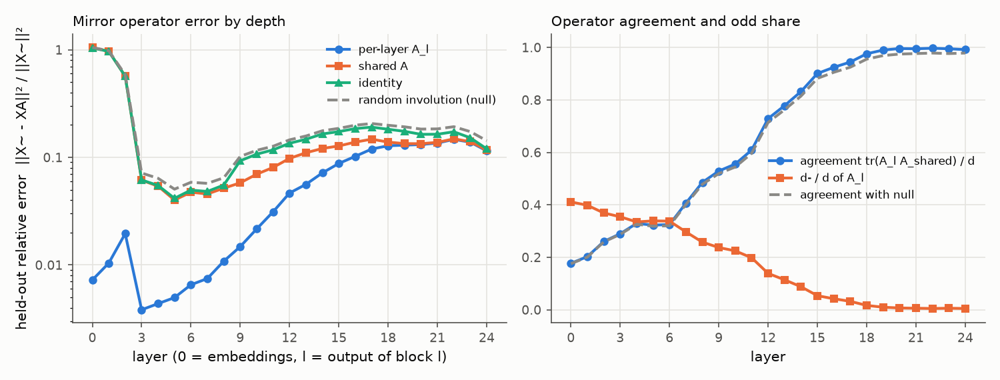
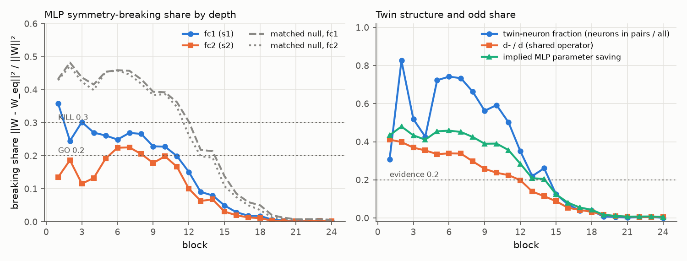

# E1 report: Mirror Surgery go/kill on dinov2_vitl14_reg

**Outcome: AMBER.** No rule fires: row(s) 4, 5 not GO and no KILL cell in rows 1, 4, 5; needs a human decision.

## Run

- Date: 2026-11-09 06:41:54; git commit `b95ccd58865b4ca52ed449edb24a6a1563478a04` (git not installed; uncommitted changes not checked); seed 0.
- Config: `configs/g_dinov2_l_reg.yaml`; device NVIDIA GeForce RTX 5090; torch 2.11.0+cu128.
- Operator under test: one operator per layer (block b: fc1 against the operator of its input layer, fc2 against its output layer; nulls and SVD ranks matched per layer). Data split: cached order of appearance.
- Data: fit 2000, held-out 1000, k-NN bank 100000, queries 50000 images (each with its mirror); protocol v2: operators fitted on ImageNet train (fit seed 0), held-out errors and k-NN queries on validation, k-NN bank from train, k-NN features in bf16.
- Total time 69.2 min. Stages (s): load 21, sanity 1, fit_stats 398, fit_operators 100, heldout_errors 112, position_check 0, mlp_matching 508, breaking_share 4, surgery_knn 2990.

## Decision table (blocks 1 to 12)

| Row | Check | Value | GO if | KILL if | Cell |
|---|---|---|---|---|---|
| 1 | e(null) / e(A_l (per layer)), mean over layers; worst layer 12: 13.1 | 79.41 | >= 5 | < 3 | **GO** |
| 2 | e(A_l (per layer)) / e(I), mean over layers; worst layer 12: 0.345 | 0.07933 | <= 0.5 | informative only | **GO** |
| 3 | d- / d (mean of per-layer A_l over layers 1 to 12) | 0.2906 | >= 0.2 | < 0.1: blocks GO, no KILL (PIVOT: little to save) | **GO** |
| 4 | MLP breaking share, max(mean s1, mean s2) [s1 0.252, s2 0.171; matched null s1 0.418, s2 0.406; twin fraction 0.579, d-/d 0.291] | 0.2522 | <= 0.2, and d-/d >= 0.2 or twin fraction >= 0.2 | > 0.3 | **AMBER** |
| 5 | Zero-shot surgery at k = 12: k-NN drop [original 80.60, surgery 79.26, SVD 78.57; margin over SVD 0.69] | 1.348 | drop <= 10 and margin >= 5 | no better than SVD (margin <= 0) | **AMBER** |

Per-layer values behind rows 1 and 2 (layer l is the output of block l). Worst layer: row 1 layer 12, row 2 layer 12.

| Layer | e(null) / e(A_l) | e(A_l) / e(I) |
|---|---|---|
| 1 | 173 | 0.01078 |
| 2 | 82.58 | 0.03444 |
| 3 | 373.5 | 0.06214 |
| 4 | 300.9 | 0.07987 |
| 5 | 283 | 0.1195 |
| 6 | 205.8 | 0.1319 |
| 7 | 161.2 | 0.1552 |
| 8 | 90.02 | 0.1961 |
| 9 | 67.39 | 0.1594 |
| 10 | 43.5 | 0.2019 |
| 11 | 26.28 | 0.2658 |
| 12 | 13.14 (worst) | 0.3447 (worst) |

How blocks are combined: rows 1 and 2 use the mean over layers 1 to 12 of the relative held-out error e / ||X~||², then the ratio of those means. Row 4 averages s1 and s2 over blocks 1 to 12 and uses the larger; a low share counts as evidence only if d-/d is at least 0.2 or the mean twin-neuron fraction is at least 0.2. Row 5 uses surgery on the first 12 blocks. Outcome, in order: KILL if any KILL cell in rows 1, 4 or 5; GO if all rows are GO; PIVOT: structure but little to save, if d-/d is below the row 3 KILL limit; PIVOT if rows 1 to 4 are GO and the drop is above the GO limit; otherwise AMBER (the table gives no verdict).

## Residual stream: one mirror operator?

Shared operator fitted on summed C over layers 1 to 24: d = 1024, d+ = 1018, d- = 6 (d-/d = 0.006). Directions with no signal (assigned +1): 1. Errors are relative, e / ||X~||², on held-out images; the null is a random orthogonal involution with the same d+ (mean of 3 seeds).

| layer | d- (A_l) | tr(A_l A)/d | e(A_l) | e(A) | e(A, scale-normalised fit) | e(I) | e(null) | e(null)/e(A) |
|---|---|---|---|---|---|---|---|---|
| 0 | 421 | 0.177 | 0.007254 | 1.048 | 0.3734 | 1.039 | 1.051 | 1 |
| 1 | 408 | 0.202 | 0.01042 | 0.9692 | 0.4075 | 0.9665 | 0.9786 | 1.01 |
| 2 | 378 | 0.260 | 0.01956 | 0.5688 | 0.2131 | 0.568 | 0.5872 | 1.03 |
| 3 | 363 | 0.290 | 0.003836 | 0.06137 | 0.02634 | 0.06173 | 0.07156 | 1.17 |
| 4 | 343 | 0.329 | 0.004376 | 0.054 | 0.02525 | 0.05478 | 0.06392 | 1.18 |
| 5 | 347 | 0.323 | 0.004977 | 0.04017 | 0.02234 | 0.04165 | 0.05066 | 1.26 |
| 6 | 346 | 0.325 | 0.006551 | 0.04747 | 0.02882 | 0.04966 | 0.05871 | 1.24 |
| 7 | 304 | 0.406 | 0.007485 | 0.04573 | 0.02863 | 0.04823 | 0.05735 | 1.25 |
| 8 | 264 | 0.486 | 0.01085 | 0.05171 | 0.03439 | 0.05533 | 0.06462 | 1.25 |
| 9 | 243 | 0.529 | 0.01482 | 0.05801 | 0.03959 | 0.093 | 0.1021 | 1.76 |
| 10 | 230 | 0.555 | 0.02162 | 0.06978 | 0.05204 | 0.1071 | 0.1163 | 1.67 |
| 11 | 203 | 0.609 | 0.03121 | 0.08064 | 0.06446 | 0.1174 | 0.1269 | 1.57 |
| 12 | 142 | 0.729 | 0.04664 | 0.09785 | 0.08226 | 0.1353 | 0.1456 | 1.49 |
| 13 | 117 | 0.778 | 0.05615 | 0.1104 | 0.0978 | 0.1474 | 0.158 | 1.43 |
| 14 | 90 | 0.832 | 0.07176 | 0.121 | 0.1134 | 0.1651 | 0.1767 | 1.46 |
| 15 | 55 | 0.901 | 0.08782 | 0.1277 | 0.1263 | 0.1737 | 0.1861 | 1.46 |
| 16 | 43 | 0.924 | 0.1022 | 0.1386 | 0.1439 | 0.1851 | 0.1991 | 1.44 |
| 17 | 33 | 0.944 | 0.1196 | 0.1477 | 0.1641 | 0.191 | 0.2063 | 1.4 |
| 18 | 17 | 0.976 | 0.1283 | 0.1386 | 0.1701 | 0.1826 | 0.1988 | 1.43 |
| 19 | 10 | 0.990 | 0.1299 | 0.1343 | 0.1777 | 0.1746 | 0.1923 | 1.43 |
| 20 | 7 | 0.996 | 0.1316 | 0.134 | 0.1876 | 0.1638 | 0.1832 | 1.37 |
| 21 | 6 | 0.995 | 0.136 | 0.1379 | 0.1981 | 0.1641 | 0.184 | 1.33 |
| 22 | 5 | 0.997 | 0.1469 | 0.1487 | 0.2126 | 0.173 | 0.1928 | 1.3 |
| 23 | 6 | 0.995 | 0.1385 | 0.14 | 0.2001 | 0.1521 | 0.1736 | 1.24 |
| 24 | 5 | 0.992 | 0.115 | 0.1169 | 0.1901 | 0.12 | 0.1429 | 1.22 |

## Position embedding

||mirror(P) - P A|| / ||P|| on the 16 x 16 patch grid (P channel-centred like the tokens; the second column also removes the mean over positions).

| Operator | channel-centred | also grid-centred |
|---|---|---|
| A_shared | 1.027 | 1.034 |
| A_0 (layer 0) | 0.295 | 0.2783 |
| identity | 1.089 | 1.096 |
| null | 1.091 | 1.098 |

Layer 0 held-out error with the shared operator: e(A) = 1.048 (e(A_0) = 0.007254, e(I) = 1.039).

## MLP twins and breaking share

Neuron involution per block from the mirrored-versus-original fc1 correlations; breaking share of the folded weights against each block's input-layer operator (fc1) and output-layer operator (fc2). Matched null (mean of 3 seeds): a random involution with the same d+ and d- as each layer's operator and, per block, a random pairing with the same numbers of pairs and self-twins as the fitted one. d-/d is that of the block's input-layer operator. If the fitted structure is nearly trivial (few odd features, few pairs), the matched null is nearly trivial too and its share is also low; a low share then is not evidence. Twin fraction = neurons in pairs / all neurons. Evidence = d-/d at least 0.2 or twin fraction at least 0.2.

| block | pairs | self-twins | twin fraction | d-/d | mean corr (pairs) | mean corr (self) | s1 | s1 matched null | s2 | s2 matched null | evidence | implied saving | SVD rank |
|---|---|---|---|---|---|---|---|---|---|---|---|---|---|
| 1 | 630 | 2836 | 0.308 | 0.411 | 0.845 | 0.713 | 0.359 | 0.432 | 0.135 | 0.429 | yes | 0.434 | 460 |
| 2 | 1691 | 714 | 0.826 | 0.398 | 0.800 | 0.798 | 0.245 | 0.482 | 0.187 | 0.471 | yes | 0.480 | 424 |
| 3 | 1062 | 1972 | 0.519 | 0.369 | 0.669 | 0.507 | 0.302 | 0.437 | 0.115 | 0.424 | yes | 0.433 | 461 |
| 4 | 873 | 2350 | 0.426 | 0.354 | 0.657 | 0.738 | 0.270 | 0.416 | 0.133 | 0.399 | yes | 0.411 | 477 |
| 5 | 1480 | 1136 | 0.723 | 0.335 | 0.757 | 0.823 | 0.261 | 0.454 | 0.191 | 0.454 | yes | 0.455 | 447 |
| 6 | 1519 | 1058 | 0.742 | 0.339 | 0.633 | 0.646 | 0.249 | 0.459 | 0.224 | 0.458 | yes | 0.458 | 443 |
| 7 | 1502 | 1092 | 0.733 | 0.338 | 0.630 | 0.721 | 0.269 | 0.457 | 0.225 | 0.446 | yes | 0.451 | 445 |
| 8 | 1356 | 1384 | 0.662 | 0.297 | 0.620 | 0.764 | 0.266 | 0.431 | 0.205 | 0.418 | yes | 0.425 | 465 |
| 9 | 1152 | 1792 | 0.562 | 0.258 | 0.644 | 0.830 | 0.228 | 0.394 | 0.178 | 0.384 | yes | 0.390 | 496 |
| 10 | 1213 | 1670 | 0.592 | 0.237 | 0.608 | 0.774 | 0.227 | 0.392 | 0.198 | 0.386 | yes | 0.390 | 497 |
| 11 | 1028 | 2040 | 0.502 | 0.225 | 0.590 | 0.810 | 0.199 | 0.362 | 0.166 | 0.348 | yes | 0.356 | 521 |
| 12 | 717 | 2662 | 0.350 | 0.198 | 0.648 | 0.866 | 0.151 | 0.303 | 0.100 | 0.262 | yes | 0.285 | 570 |
| 13 | 450 | 3196 | 0.220 | 0.139 | 0.696 | 0.894 | 0.090 | 0.218 | 0.063 | 0.198 | yes | 0.209 | 640 |
| 14 | 534 | 3028 | 0.261 | 0.114 | 0.678 | 0.910 | 0.080 | 0.214 | 0.068 | 0.194 | yes | 0.205 | 643 |
| 15 | 255 | 3586 | 0.125 | 0.088 | 0.724 | 0.919 | 0.049 | 0.138 | 0.031 | 0.108 | no | 0.124 | 705 |
| 16 | 147 | 3802 | 0.072 | 0.054 | 0.773 | 0.926 | 0.029 | 0.085 | 0.020 | 0.075 | no | 0.080 | 748 |
| 17 | 79 | 3938 | 0.039 | 0.042 | 0.715 | 0.927 | 0.018 | 0.059 | 0.013 | 0.050 | no | 0.055 | 770 |
| 18 | 80 | 3936 | 0.039 | 0.032 | 0.783 | 0.935 | 0.018 | 0.050 | 0.011 | 0.035 | no | 0.043 | 777 |
| 19 | 14 | 4068 | 0.007 | 0.017 | 0.732 | 0.935 | 0.007 | 0.020 | 0.003 | 0.013 | no | 0.017 | 802 |
| 20 | 11 | 4074 | 0.005 | 0.010 | 0.731 | 0.933 | 0.003 | 0.012 | 0.002 | 0.009 | no | 0.011 | 809 |
| 21 | 3 | 4090 | 0.001 | 0.007 | 0.727 | 0.920 | 0.002 | 0.007 | 0.001 | 0.007 | no | 0.007 | 813 |
| 22 | 9 | 4078 | 0.004 | 0.006 | 0.787 | 0.919 | 0.002 | 0.008 | 0.002 | 0.007 | no | 0.008 | 812 |
| 23 | 11 | 4074 | 0.005 | 0.005 | 0.782 | 0.920 | 0.002 | 0.007 | 0.003 | 0.008 | no | 0.008 | 813 |
| 24 | 1 | 4094 | 0.000 | 0.006 | 0.131 | 0.953 | 0.002 | 0.006 | 0.001 | 0.005 | no | 0.006 | 814 |

## Zero-shot surgery (k-NN, k = 20, T = 0.07)

Surgery replaces the MLPs of the first k blocks by their nearest mirror-equivariant weights. SVD keeps the same number of parameters as a rank-r factorisation. Random uses the null operator and pairing. Top-1 and flip consistency are in percent.

| k | variant | top-1 | drop (points) | flip consistency | MLP params kept (first k blocks) |
|---|---|---|---|---|---|
| 0 | original | 80.60 | 0.00 | 97.75 | 1.000 |
| 12 | surgery | 79.26 | 1.35 | 93.07 | 0.586 |
| 12 | svd | 78.57 | 2.04 | 94.54 | 0.585 |
| 12 | random | 4.28 | 76.32 | 22.33 | 0.586 |

## Sanity checks in this run

- Folding (block 0, one fit batch): max abs difference 8.58e-06.
- Identity surgery on all blocks (A = I, P = I), CLS features of one batch: max abs difference 1.06e-05.

All numbers come from `scripts/run_e1.py` with the config, seed and commit above; per-layer and per-block values are in `results/e1_layers.csv`, `results/e1_mlp.csv` and `results/e1_surgery.csv`.
