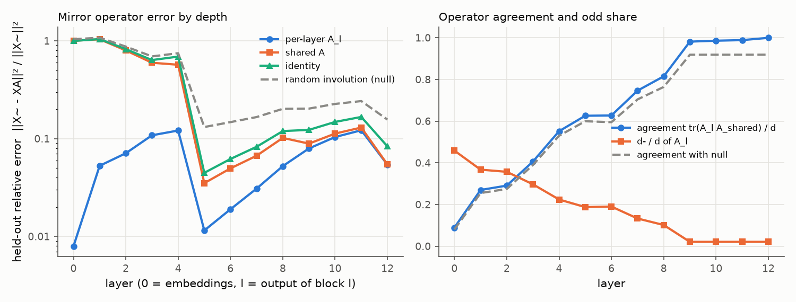
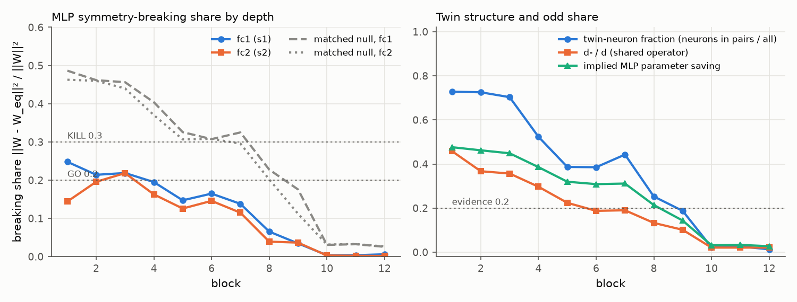

# E1 report: Mirror Surgery go/kill on dinov2_vits14_reg

**Outcome: PIVOT.** Structure checks pass but the surgery drop is 18.42 points (above 10); run the 1-hour healing check.

## Run

- Date: 2026-11-09 06:49:33; git commit `b95ccd58865b4ca52ed449edb24a6a1563478a04` (git not installed; uncommitted changes not checked); seed 0.
- Config: `configs/g_dinov2_s_reg.yaml`; device NVIDIA GeForce RTX 5090; torch 2.11.0+cu128.
- Operator under test: one operator per layer (block b: fc1 against the operator of its input layer, fc2 against its output layer; nulls and SVD ranks matched per layer). Data split: cached order of appearance.
- Data: fit 2000, held-out 1000, k-NN bank 100000, queries 50000 images (each with its mirror); protocol v2: operators fitted on ImageNet train (fit seed 0), held-out errors and k-NN queries on validation, k-NN bank from train, k-NN features in bf16.
- Total time 19.3 min. Stages (s): load 21, sanity 1, fit_stats 167, fit_operators 7, heldout_errors 48, position_check 0, mlp_matching 36, breaking_share 7, surgery_knn 870.

## Decision table (blocks 1 to 6)

| Row | Check | Value | GO if | KILL if | Cell |
|---|---|---|---|---|---|
| 1 | e(null) / e(A_l (per layer)), mean over layers; worst layer 4: 10.7 | 20.32 | >= 5 | < 3 | **GO** |
| 2 | e(A_l (per layer)) / e(I), mean over layers; worst layer 6: 0.306 | 0.1163 | <= 0.5 | informative only | **GO** |
| 3 | d- / d (mean of per-layer A_l over layers 1 to 6) | 0.2704 | >= 0.2 | < 0.1: blocks GO, no KILL (PIVOT: little to save) | **GO** |
| 4 | MLP breaking share, max(mean s1, mean s2) [s1 0.198, s2 0.165; matched null s1 0.407, s2 0.391; twin fraction 0.575, d-/d 0.270] | 0.198 | <= 0.2, and d-/d >= 0.2 or twin fraction >= 0.2 | > 0.3 | **GO** |
| 5 | Zero-shot surgery at k = 6: k-NN drop [original 74.46, surgery 56.03, SVD 10.24; margin over SVD 45.79] | 18.42 | drop <= 10 and margin >= 5 | no better than SVD (margin <= 0) | **AMBER** |

Per-layer values behind rows 1 and 2 (layer l is the output of block l). Worst layer: row 1 layer 4, row 2 layer 6.

| Layer | e(null) / e(A_l) | e(A_l) / e(I) |
|---|---|---|
| 1 | 33.13 | 0.05063 |
| 2 | 23.69 | 0.0862 |
| 3 | 13.36 | 0.1701 |
| 4 | 10.68 (worst) | 0.1754 |
| 5 | 70.72 | 0.2575 |
| 6 | 42.83 | 0.306 (worst) |

How blocks are combined: rows 1 and 2 use the mean over layers 1 to 6 of the relative held-out error e / ||X~||², then the ratio of those means. Row 4 averages s1 and s2 over blocks 1 to 6 and uses the larger; a low share counts as evidence only if d-/d is at least 0.2 or the mean twin-neuron fraction is at least 0.2. Row 5 uses surgery on the first 6 blocks. Outcome, in order: KILL if any KILL cell in rows 1, 4 or 5; GO if all rows are GO; PIVOT: structure but little to save, if d-/d is below the row 3 KILL limit; PIVOT if rows 1 to 4 are GO and the drop is above the GO limit; otherwise AMBER (the table gives no verdict).

## Residual stream: one mirror operator?

Shared operator fitted on summed C over layers 1 to 12: d = 384, d+ = 376, d- = 8 (d-/d = 0.021). Directions with no signal (assigned +1): 1. Errors are relative, e / ||X~||², on held-out images; the null is a random orthogonal involution with the same d+ (mean of 3 seeds).

| layer | d- (A_l) | tr(A_l A)/d | e(A_l) | e(A) | e(A, scale-normalised fit) | e(I) | e(null) | e(null)/e(A) |
|---|---|---|---|---|---|---|---|---|
| 0 | 176 | 0.089 | 0.007945 | 1.001 | 0.586 | 0.9971 | 1.038 | 1.04 |
| 1 | 141 | 0.270 | 0.05276 | 1.036 | 0.5775 | 1.042 | 1.076 | 1.04 |
| 2 | 137 | 0.291 | 0.07085 | 0.7973 | 0.4083 | 0.822 | 0.8728 | 1.09 |
| 3 | 114 | 0.406 | 0.1081 | 0.5969 | 0.2909 | 0.6356 | 0.6929 | 1.16 |
| 4 | 86 | 0.552 | 0.121 | 0.5692 | 0.322 | 0.6896 | 0.7465 | 1.31 |
| 5 | 72 | 0.626 | 0.01151 | 0.03504 | 0.02592 | 0.04469 | 0.1314 | 3.75 |
| 6 | 73 | 0.627 | 0.01895 | 0.04961 | 0.04067 | 0.06192 | 0.1474 | 2.97 |
| 7 | 51 | 0.746 | 0.03085 | 0.06688 | 0.06415 | 0.08254 | 0.1661 | 2.48 |
| 8 | 39 | 0.815 | 0.05233 | 0.1017 | 0.1123 | 0.1194 | 0.2016 | 1.98 |
| 9 | 8 | 0.981 | 0.07933 | 0.08889 | 0.1437 | 0.1228 | 0.2027 | 2.28 |
| 10 | 8 | 0.986 | 0.1038 | 0.1126 | 0.202 | 0.1482 | 0.2263 | 2.01 |
| 11 | 8 | 0.988 | 0.1217 | 0.1298 | 0.2353 | 0.1666 | 0.242 | 1.86 |
| 12 | 8 | 0.999 | 0.05409 | 0.05445 | 0.22 | 0.0833 | 0.1566 | 2.88 |

## Position embedding

||mirror(P) - P A|| / ||P|| on the 16 x 16 patch grid (P channel-centred like the tokens; the second column also removes the mean over positions).

| Operator | channel-centred | also grid-centred |
|---|---|---|
| A_shared | 0.6483 | 0.6731 |
| A_0 (layer 0) | 0.2333 | 0.1789 |
| identity | 0.9445 | 0.982 |
| null | 0.9566 | 0.9921 |

Layer 0 held-out error with the shared operator: e(A) = 1.001 (e(A_0) = 0.007945, e(I) = 0.9971).

## MLP twins and breaking share

Neuron involution per block from the mirrored-versus-original fc1 correlations; breaking share of the folded weights against each block's input-layer operator (fc1) and output-layer operator (fc2). Matched null (mean of 3 seeds): a random involution with the same d+ and d- as each layer's operator and, per block, a random pairing with the same numbers of pairs and self-twins as the fitted one. d-/d is that of the block's input-layer operator. If the fitted structure is nearly trivial (few odd features, few pairs), the matched null is nearly trivial too and its share is also low; a low share then is not evidence. Twin fraction = neurons in pairs / all neurons. Evidence = d-/d at least 0.2 or twin fraction at least 0.2.

| block | pairs | self-twins | twin fraction | d-/d | mean corr (pairs) | mean corr (self) | s1 | s1 matched null | s2 | s2 matched null | evidence | implied saving | SVD rank |
|---|---|---|---|---|---|---|---|---|---|---|---|---|---|
| 1 | 559 | 418 | 0.728 | 0.458 | 0.770 | 0.841 | 0.248 | 0.487 | 0.144 | 0.463 | yes | 0.476 | 157 |
| 2 | 557 | 422 | 0.725 | 0.367 | 0.727 | 0.824 | 0.214 | 0.462 | 0.196 | 0.460 | yes | 0.462 | 164 |
| 3 | 540 | 456 | 0.703 | 0.357 | 0.625 | 0.673 | 0.219 | 0.456 | 0.218 | 0.440 | yes | 0.449 | 166 |
| 4 | 402 | 732 | 0.523 | 0.297 | 0.639 | 0.810 | 0.195 | 0.404 | 0.163 | 0.370 | yes | 0.386 | 183 |
| 5 | 297 | 942 | 0.387 | 0.224 | 0.618 | 0.870 | 0.147 | 0.326 | 0.126 | 0.307 | yes | 0.320 | 205 |
| 6 | 296 | 944 | 0.385 | 0.188 | 0.572 | 0.805 | 0.165 | 0.307 | 0.146 | 0.308 | yes | 0.309 | 212 |
| 7 | 340 | 856 | 0.443 | 0.190 | 0.625 | 0.870 | 0.138 | 0.325 | 0.115 | 0.296 | yes | 0.311 | 206 |
| 8 | 194 | 1148 | 0.253 | 0.133 | 0.780 | 0.921 | 0.065 | 0.228 | 0.039 | 0.202 | yes | 0.214 | 237 |
| 9 | 144 | 1248 | 0.188 | 0.102 | 0.739 | 0.937 | 0.034 | 0.176 | 0.037 | 0.112 | no | 0.143 | 253 |
| 10 | 17 | 1502 | 0.022 | 0.021 | 0.825 | 0.941 | 0.004 | 0.031 | 0.003 | 0.032 | no | 0.031 | 297 |
| 11 | 20 | 1496 | 0.026 | 0.021 | 0.870 | 0.935 | 0.004 | 0.032 | 0.002 | 0.033 | no | 0.033 | 296 |
| 12 | 10 | 1516 | 0.013 | 0.021 | 0.930 | 0.975 | 0.006 | 0.026 | 0.002 | 0.026 | no | 0.027 | 298 |

## Zero-shot surgery (k-NN, k = 20, T = 0.07)

Surgery replaces the MLPs of the first k blocks by their nearest mirror-equivariant weights. SVD keeps the same number of parameters as a rank-r factorisation. Random uses the null operator and pairing. Top-1 and flip consistency are in percent.

| k | variant | top-1 | drop (points) | flip consistency | MLP params kept (first k blocks) |
|---|---|---|---|---|---|
| 0 | original | 74.46 | 0.00 | 93.22 | 1.000 |
| 6 | surgery | 56.03 | 18.42 | 67.20 | 0.600 |
| 6 | svd | 10.24 | 64.21 | 27.32 | 0.598 |
| 6 | random | 2.84 | 71.61 | 9.08 | 0.600 |

## Sanity checks in this run

- Folding (block 0, one fit batch): max abs difference 2.86e-06.
- Identity surgery on all blocks (A = I, P = I), CLS features of one batch: max abs difference 1e-05.

All numbers come from `scripts/run_e1.py` with the config, seed and commit above; per-layer and per-block values are in `results/e1_layers.csv`, `results/e1_mlp.csv` and `results/e1_surgery.csv`.
