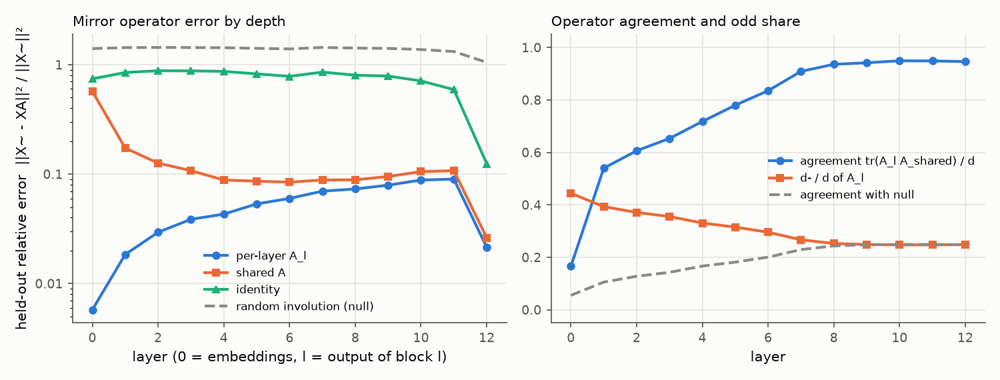
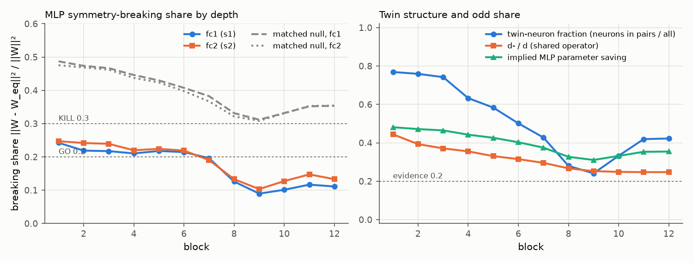

# E1 report: Mirror Surgery go/kill on mae_b16

**Outcome: AMBER.** No rule fires: row(s) 4, 5 not GO and no KILL cell in rows 1, 4, 5; needs a human decision.

## Run

- Date: 2026-11-09 08:07:30; git commit `b95ccd58865b4ca52ed449edb24a6a1563478a04` (git not installed; uncommitted changes not checked); seed 0.
- Config: `configs/g_mae_b16.yaml`; device NVIDIA GeForce RTX 5090; torch 2.11.0+cu128.
- Operator under test: one operator per layer (block b: fc1 against the operator of its input layer, fc2 against its output layer; nulls and SVD ranks matched per layer). Data split: cached order of appearance.
- Data: fit 2000, held-out 1000, k-NN bank 100000, queries 50000 images (each with its mirror); protocol v2: operators fitted on ImageNet train (fit seed 0), held-out errors and k-NN queries on validation, k-NN bank from train, k-NN features in bf16.
- Total time 29.1 min. Stages (s): load 18, sanity 1, fit_stats 275, fit_operators 75, heldout_errors 91, position_check 0, mlp_matching 204, breaking_share 6, surgery_knn 1070.

## Decision table (blocks 1 to 6)

| Row | Check | Value | GO if | KILL if | Cell |
|---|---|---|---|---|---|
| 1 | e(null) / e(A_l (per layer)), mean over layers; worst layer 6: 25.2 | 40.76 | >= 5 | < 3 | **GO** |
| 2 | e(A_l (per layer)) / e(I), mean over layers; worst layer 6: 0.0766 | 0.04777 | <= 0.5 | informative only | **GO** |
| 3 | d- / d (mean of per-layer A_l over layers 1 to 6) | 0.3435 | >= 0.2 | < 0.1: blocks GO, no KILL (PIVOT: little to save) | **GO** |
| 4 | MLP breaking share, max(mean s1, mean s2) [s1 0.220, s2 0.232; matched null s1 0.452, s2 0.444; twin fraction 0.665, d-/d 0.344] | 0.2319 | <= 0.2, and d-/d >= 0.2 or twin fraction >= 0.2 | > 0.3 | **AMBER** |
| 5 | Zero-shot surgery at k = 6: k-NN drop [original 13.73, surgery 8.13, SVD 3.55; margin over SVD 4.58] | 5.604 | drop <= 10 and margin >= 5 | no better than SVD (margin <= 0) | **AMBER** |

Per-layer values behind rows 1 and 2 (layer l is the output of block l). Worst layer: row 1 layer 6, row 2 layer 6.

| Layer | e(null) / e(A_l) | e(A_l) / e(I) |
|---|---|---|
| 1 | 96.19 | 0.02169 |
| 2 | 58.83 | 0.03341 |
| 3 | 43.55 | 0.04397 |
| 4 | 37.34 | 0.04956 |
| 5 | 29.88 | 0.06479 |
| 6 | 25.22 (worst) | 0.07657 (worst) |

How blocks are combined: rows 1 and 2 use the mean over layers 1 to 6 of the relative held-out error e / ||X~||², then the ratio of those means. Row 4 averages s1 and s2 over blocks 1 to 6 and uses the larger; a low share counts as evidence only if d-/d is at least 0.2 or the mean twin-neuron fraction is at least 0.2. Row 5 uses surgery on the first 6 blocks. Outcome, in order: KILL if any KILL cell in rows 1, 4 or 5; GO if all rows are GO; PIVOT: structure but little to save, if d-/d is below the row 3 KILL limit; PIVOT if rows 1 to 4 are GO and the drop is above the GO limit; otherwise AMBER (the table gives no verdict).

## Residual stream: one mirror operator?

Shared operator fitted on summed C over layers 1 to 12: d = 768, d+ = 573, d- = 195 (d-/d = 0.254). Directions with no signal (assigned +1): 1. Errors are relative, e / ||X~||², on held-out images; the null is a random orthogonal involution with the same d+ (mean of 3 seeds).

| layer | d- (A_l) | tr(A_l A)/d | e(A_l) | e(A) | e(A, scale-normalised fit) | e(I) | e(null) | e(null)/e(A) |
|---|---|---|---|---|---|---|---|---|
| 0 | 341 | 0.166 | 0.005755 | 0.5708 | 0.4913 | 0.7428 | 1.403 | 2.46 |
| 1 | 302 | 0.540 | 0.01841 | 0.173 | 0.1223 | 0.8485 | 1.433 | 8.28 |
| 2 | 285 | 0.606 | 0.02942 | 0.126 | 0.09541 | 0.8805 | 1.437 | 11.4 |
| 3 | 273 | 0.653 | 0.03862 | 0.1076 | 0.08777 | 0.8783 | 1.435 | 13.3 |
| 4 | 254 | 0.718 | 0.04306 | 0.08832 | 0.07741 | 0.8688 | 1.43 | 16.2 |
| 5 | 242 | 0.780 | 0.05342 | 0.08618 | 0.08016 | 0.8246 | 1.411 | 16.4 |
| 6 | 227 | 0.835 | 0.05994 | 0.0844 | 0.0827 | 0.7828 | 1.394 | 16.5 |
| 7 | 205 | 0.909 | 0.06984 | 0.08838 | 0.09101 | 0.8556 | 1.438 | 16.3 |
| 8 | 194 | 0.936 | 0.07316 | 0.08873 | 0.09537 | 0.8023 | 1.419 | 16 |
| 9 | 191 | 0.941 | 0.07924 | 0.09511 | 0.1064 | 0.7873 | 1.41 | 14.8 |
| 10 | 190 | 0.949 | 0.08828 | 0.1053 | 0.1236 | 0.7108 | 1.376 | 13.1 |
| 11 | 190 | 0.949 | 0.08997 | 0.1075 | 0.1325 | 0.5924 | 1.32 | 12.3 |
| 12 | 191 | 0.946 | 0.02144 | 0.02621 | 0.03545 | 0.1246 | 1.05 | 40 |

## Position embedding

||mirror(P) - P A|| / ||P|| on the 14 x 14 patch grid (P channel-centred like the tokens; the second column also removes the mean over positions).

| Operator | channel-centred | also grid-centred |
|---|---|---|
| A_shared | 0.9252 | 0.9487 |
| A_0 (layer 0) | 0.9795 | 0.04018 |
| identity | 0.6481 | 1.131 |
| null | 1.157 | 1.275 |

Layer 0 held-out error with the shared operator: e(A) = 0.5708 (e(A_0) = 0.005755, e(I) = 0.7428).

## MLP twins and breaking share

Neuron involution per block from the mirrored-versus-original fc1 correlations; breaking share of the folded weights against each block's input-layer operator (fc1) and output-layer operator (fc2). Matched null (mean of 3 seeds): a random involution with the same d+ and d- as each layer's operator and, per block, a random pairing with the same numbers of pairs and self-twins as the fitted one. d-/d is that of the block's input-layer operator. If the fitted structure is nearly trivial (few odd features, few pairs), the matched null is nearly trivial too and its share is also low; a low share then is not evidence. Twin fraction = neurons in pairs / all neurons. Evidence = d-/d at least 0.2 or twin fraction at least 0.2.

| block | pairs | self-twins | twin fraction | d-/d | mean corr (pairs) | mean corr (self) | s1 | s1 matched null | s2 | s2 matched null | evidence | implied saving | SVD rank |
|---|---|---|---|---|---|---|---|---|---|---|---|---|---|
| 1 | 1181 | 710 | 0.769 | 0.444 | 0.784 | 0.793 | 0.242 | 0.487 | 0.247 | 0.475 | yes | 0.481 | 315 |
| 2 | 1166 | 740 | 0.759 | 0.393 | 0.740 | 0.846 | 0.219 | 0.474 | 0.242 | 0.469 | yes | 0.472 | 323 |
| 3 | 1140 | 792 | 0.742 | 0.371 | 0.716 | 0.773 | 0.217 | 0.467 | 0.239 | 0.462 | yes | 0.465 | 327 |
| 4 | 972 | 1128 | 0.633 | 0.355 | 0.682 | 0.725 | 0.211 | 0.446 | 0.220 | 0.437 | yes | 0.442 | 339 |
| 5 | 896 | 1280 | 0.583 | 0.331 | 0.670 | 0.730 | 0.218 | 0.430 | 0.224 | 0.424 | yes | 0.426 | 350 |
| 6 | 770 | 1532 | 0.501 | 0.315 | 0.635 | 0.723 | 0.214 | 0.408 | 0.219 | 0.398 | yes | 0.403 | 363 |
| 7 | 657 | 1758 | 0.428 | 0.296 | 0.625 | 0.757 | 0.196 | 0.383 | 0.190 | 0.367 | yes | 0.375 | 379 |
| 8 | 430 | 2212 | 0.280 | 0.267 | 0.646 | 0.830 | 0.126 | 0.331 | 0.133 | 0.322 | yes | 0.327 | 410 |
| 9 | 370 | 2332 | 0.241 | 0.253 | 0.676 | 0.846 | 0.090 | 0.312 | 0.103 | 0.308 | yes | 0.311 | 422 |
| 10 | 511 | 2050 | 0.333 | 0.249 | 0.640 | 0.838 | 0.101 | 0.332 | 0.127 | 0.331 | yes | 0.332 | 410 |
| 11 | 644 | 1784 | 0.419 | 0.247 | 0.637 | 0.810 | 0.117 | 0.352 | 0.147 | 0.353 | yes | 0.353 | 397 |
| 12 | 649 | 1774 | 0.423 | 0.247 | 0.705 | 0.807 | 0.111 | 0.353 | 0.133 | 0.354 | yes | 0.355 | 396 |

## Zero-shot surgery (k-NN, k = 20, T = 0.07)

Surgery replaces the MLPs of the first k blocks by their nearest mirror-equivariant weights. SVD keeps the same number of parameters as a rank-r factorisation. Random uses the null operator and pairing. Top-1 and flip consistency are in percent.

| k | variant | top-1 | drop (points) | flip consistency | MLP params kept (first k blocks) |
|---|---|---|---|---|---|
| 0 | original | 13.73 | 0.00 | 54.53 | 1.000 |
| 6 | surgery | 8.13 | 5.60 | 50.45 | 0.552 |
| 6 | svd | 3.55 | 10.18 | 37.58 | 0.551 |
| 6 | random | 1.54 | 12.20 | 5.53 | 0.552 |

## Sanity checks in this run

- Folding (block 0, one fit batch): max abs difference 1.62e-05.
- Identity surgery on all blocks (A = I, P = I), CLS features of one batch: max abs difference 2.86e-06.

All numbers come from `scripts/run_e1.py` with the config, seed and commit above; per-layer and per-block values are in `results/e1_layers.csv`, `results/e1_mlp.csv` and `results/e1_surgery.csv`.
