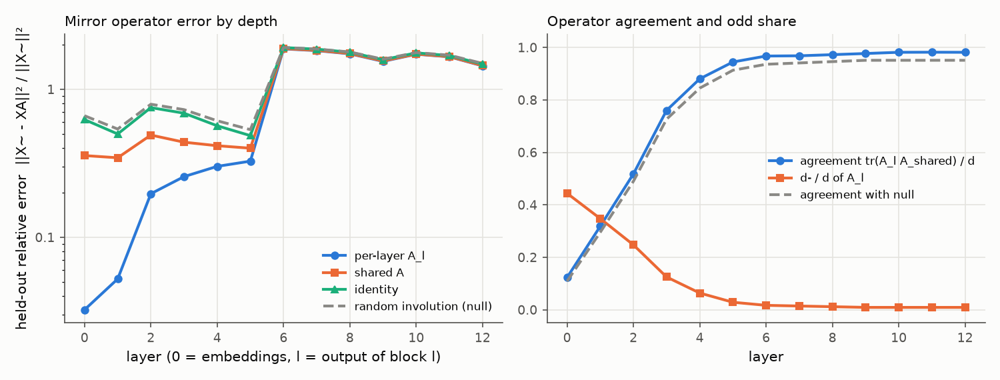
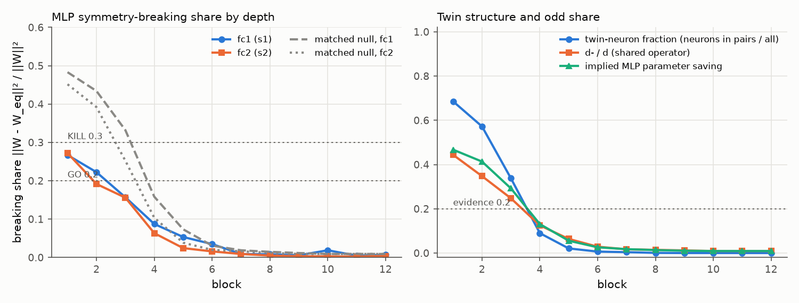

# E1 report: Mirror Surgery go/kill on siglip2_b16

**Outcome: KILL.** KILL cell in row(s) 1.

## Run

- Date: 2026-11-08 10:09:19; git commit `98faa6454f6447b57958487eea0fd57a44676947`; seed 0.
- Config: `configs/g_siglip2_b16.yaml`; device NVIDIA A100-SXM4-80GB; torch 2.11.0+cu128.
- Operator under test: one operator per layer (block b: fc1 against the operator of its input layer, fc2 against its output layer; nulls and SVD ranks matched per layer). Data split: cached order of appearance.
- Data: fit 2000, held-out 1000, k-NN bank 100000, queries 50000 images (each with its mirror); protocol v2: operators fitted on ImageNet train (fit seed 0), held-out errors and k-NN queries on validation, k-NN bank from train, k-NN features in bf16.
- Total time 79.1 min. Stages (s): load 17, sanity 2, fit_stats 78, fit_operators 1482, heldout_errors 48, position_check 2, mlp_matching 755, breaking_share 8, surgery_knn 2326.

## Decision table (blocks 1 to 6)

| Row | Check | Value | GO if | KILL if | Cell |
|---|---|---|---|---|---|
| 1 | e(null) / e(A_l (per layer)), mean over layers; worst layer 6: 1.02 | 2.378 | >= 5 | < 3 | **KILL** |
| 2 | e(A_l (per layer)) / e(I), mean over layers; worst layer 6: 0.98 | 0.6133 | <= 0.5 | informative only | **INFO** |
| 3 | d- / d (mean of per-layer A_l over layers 1 to 6) | 0.1382 | >= 0.2 | < 0.1: blocks GO, no KILL (PIVOT: little to save) | **AMBER** |
| 4 | MLP breaking share, max(mean s1, mean s2) [s1 0.137, s2 0.121; matched null s1 0.252, s2 0.210; twin fraction 0.285, d-/d 0.138] | 0.137 | <= 0.2, and d-/d >= 0.2 or twin fraction >= 0.2 | > 0.3 | **GO** |
| 5 | Zero-shot surgery at k = 6: k-NN drop [original 75.53, surgery 13.83, SVD 9.13; margin over SVD 4.70] | 61.7 | drop <= 10 and margin >= 5 | no better than SVD (margin <= 0) | **AMBER** |

Per-layer values behind rows 1 and 2 (layer l is the output of block l). Worst layer: row 1 layer 6, row 2 layer 6.

| Layer | e(null) / e(A_l) | e(A_l) / e(I) |
|---|---|---|
| 1 | 29.38 | 0.1049 |
| 2 | 6.926 | 0.2619 |
| 3 | 3.919 | 0.3728 |
| 4 | 2.511 | 0.5317 |
| 5 | 1.762 | 0.6721 |
| 6 | 1.022 (worst) | 0.9797 (worst) |

How blocks are combined: rows 1 and 2 use the mean over layers 1 to 6 of the relative held-out error e / ||X~||², then the ratio of those means. Row 4 averages s1 and s2 over blocks 1 to 6 and uses the larger; a low share counts as evidence only if d-/d is at least 0.2 or the mean twin-neuron fraction is at least 0.2. Row 5 uses surgery on the first 6 blocks. Outcome, in order: KILL if any KILL cell in rows 1, 4 or 5; GO if all rows are GO; PIVOT: structure but little to save, if d-/d is below the row 3 KILL limit; PIVOT if rows 1 to 4 are GO and the drop is above the GO limit; otherwise AMBER (the table gives no verdict).

## Residual stream: one mirror operator?

Shared operator fitted on summed C over layers 1 to 12: d = 768, d+ = 756, d- = 12 (d-/d = 0.016). Directions with no signal (assigned +1): 1. Errors are relative, e / ||X~||², on held-out images; the null is a random orthogonal involution with the same d+ (mean of 3 seeds).

| layer | d- (A_l) | tr(A_l A)/d | e(A_l) | e(A) | e(A, scale-normalised fit) | e(I) | e(null) | e(null)/e(A) |
|---|---|---|---|---|---|---|---|---|
| 0 | 341 | 0.123 | 0.03238 | 0.3566 | 0.2447 | 0.624 | 0.6626 | 1.86 |
| 1 | 267 | 0.318 | 0.05231 | 0.3446 | 0.1781 | 0.4989 | 0.5388 | 1.56 |
| 2 | 190 | 0.518 | 0.1969 | 0.4905 | 0.3074 | 0.7517 | 0.7925 | 1.62 |
| 3 | 96 | 0.760 | 0.257 | 0.439 | 0.3119 | 0.6892 | 0.7286 | 1.66 |
| 4 | 49 | 0.880 | 0.3014 | 0.4156 | 0.3474 | 0.5668 | 0.6128 | 1.47 |
| 5 | 22 | 0.945 | 0.3268 | 0.3998 | 0.3759 | 0.4863 | 0.5336 | 1.33 |
| 6 | 13 | 0.967 | 1.875 | 1.883 | 1.889 | 1.914 | 1.917 | 1.02 |
| 7 | 11 | 0.968 | 1.824 | 1.833 | 1.841 | 1.867 | 1.871 | 1.02 |
| 8 | 9 | 0.973 | 1.736 | 1.744 | 1.757 | 1.779 | 1.786 | 1.02 |
| 9 | 7 | 0.977 | 1.543 | 1.554 | 1.576 | 1.584 | 1.597 | 1.03 |
| 10 | 7 | 0.982 | 1.725 | 1.729 | 1.743 | 1.762 | 1.77 | 1.02 |
| 11 | 7 | 0.982 | 1.657 | 1.662 | 1.681 | 1.689 | 1.7 | 1.02 |
| 12 | 7 | 0.981 | 1.44 | 1.446 | 1.474 | 1.478 | 1.496 | 1.03 |

## Position embedding

||mirror(P) - P A|| / ||P|| on the 14 x 14 patch grid (P channel-centred like the tokens; the second column also removes the mean over positions).

| Operator | channel-centred | also grid-centred |
|---|---|---|
| A_shared | 0.4183 | 0.5788 |
| A_0 (layer 0) | 0.7883 | 0.2687 |
| identity | 0.5759 | 1.006 |
| null | 0.6125 | 1.019 |

Layer 0 held-out error with the shared operator: e(A) = 0.3566 (e(A_0) = 0.03238, e(I) = 0.624).

## MLP twins and breaking share

Neuron involution per block from the mirrored-versus-original fc1 correlations; breaking share of the folded weights against each block's input-layer operator (fc1) and output-layer operator (fc2). Matched null (mean of 3 seeds): a random involution with the same d+ and d- as each layer's operator and, per block, a random pairing with the same numbers of pairs and self-twins as the fitted one. d-/d is that of the block's input-layer operator. If the fitted structure is nearly trivial (few odd features, few pairs), the matched null is nearly trivial too and its share is also low; a low share then is not evidence. Twin fraction = neurons in pairs / all neurons. Evidence = d-/d at least 0.2 or twin fraction at least 0.2.

| block | pairs | self-twins | twin fraction | d-/d | mean corr (pairs) | mean corr (self) | s1 | s1 matched null | s2 | s2 matched null | evidence | implied saving | SVD rank |
|---|---|---|---|---|---|---|---|---|---|---|---|---|---|
| 1 | 1053 | 966 | 0.686 | 0.444 | 0.717 | 0.640 | 0.267 | 0.483 | 0.272 | 0.452 | yes | 0.467 | 318 |
| 2 | 879 | 1314 | 0.572 | 0.348 | 0.689 | 0.780 | 0.222 | 0.434 | 0.192 | 0.392 | yes | 0.413 | 347 |
| 3 | 519 | 2034 | 0.338 | 0.247 | 0.603 | 0.799 | 0.157 | 0.332 | 0.156 | 0.252 | yes | 0.292 | 409 |
| 4 | 138 | 2796 | 0.090 | 0.125 | 0.585 | 0.808 | 0.087 | 0.159 | 0.063 | 0.103 | no | 0.131 | 516 |
| 5 | 32 | 3008 | 0.021 | 0.064 | 0.584 | 0.794 | 0.053 | 0.073 | 0.024 | 0.039 | no | 0.056 | 569 |
| 6 | 10 | 3052 | 0.007 | 0.029 | 0.677 | 0.788 | 0.035 | 0.031 | 0.016 | 0.020 | no | 0.026 | 594 |
| 7 | 6 | 3060 | 0.004 | 0.017 | 0.378 | 0.786 | 0.009 | 0.019 | 0.009 | 0.016 | no | 0.018 | 602 |
| 8 | 1 | 3070 | 0.001 | 0.014 | 0.269 | 0.805 | 0.008 | 0.015 | 0.005 | 0.012 | no | 0.013 | 605 |
| 9 | 0 | 3072 | 0.000 | 0.012 | n/a | 0.799 | 0.006 | 0.012 | 0.003 | 0.009 | no | 0.010 | 607 |
| 10 | 0 | 3072 | 0.000 | 0.009 | n/a | 0.782 | 0.019 | 0.009 | 0.003 | 0.009 | no | 0.009 | 608 |
| 11 | 0 | 3072 | 0.000 | 0.009 | n/a | 0.763 | 0.005 | 0.009 | 0.002 | 0.009 | no | 0.009 | 608 |
| 12 | 0 | 3072 | 0.000 | 0.009 | n/a | 0.760 | 0.007 | 0.009 | 0.004 | 0.009 | no | 0.009 | 608 |

## Zero-shot surgery (k-NN, k = 20, T = 0.07)

Surgery replaces the MLPs of the first k blocks by their nearest mirror-equivariant weights. SVD keeps the same number of parameters as a rank-r factorisation. Random uses the null operator and pairing. Top-1 and flip consistency are in percent.

| k | variant | top-1 | drop (points) | flip consistency | MLP params kept (first k blocks) |
|---|---|---|---|---|---|
| 0 | original | 75.53 | 0.00 | 92.95 | 1.000 |
| 6 | surgery | 13.83 | 61.70 | 20.82 | 0.769 |
| 6 | svd | 9.13 | 66.40 | 23.32 | 0.768 |
| 6 | random | 1.06 | 74.47 | 3.58 | 0.769 |

## Sanity checks in this run

- Folding (block 0, one fit batch): max abs difference 8.58e-06.
- Identity surgery on all blocks (A = I, P = I), CLS features of one batch: max abs difference 3.52e-06.

All numbers come from `scripts/run_e1.py` with the config, seed and commit above; per-layer and per-block values are in `results/e1_layers.csv`, `results/e1_mlp.csv` and `results/e1_surgery.csv`.
