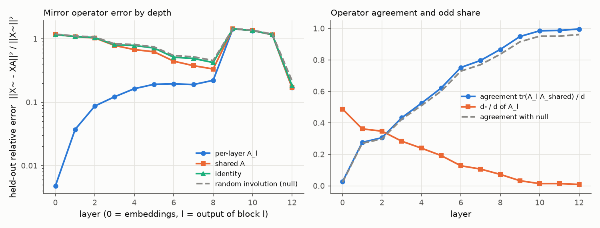
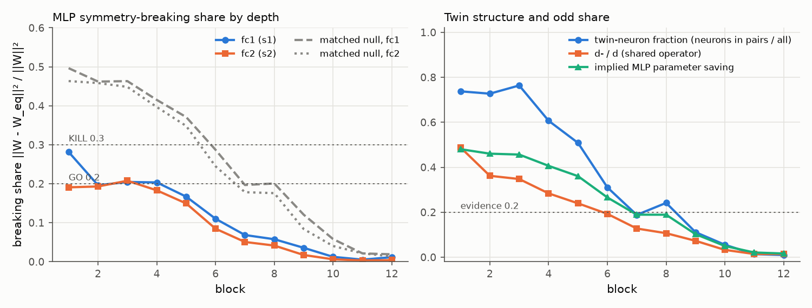

# E1 report: Mirror Surgery go/kill on dinov2_vitb14

**Outcome: GO.** Every check is in its GO cell.

## Run

- Date: 2026-11-08 13:31:54; git commit `94b2e19d8b902ca0ed6c65436d4155baa6fee8a3` (uncommitted changes present); seed 0.
- Config: `configs/x2_perlayer_plain.yaml`; device NVIDIA A100-SXM4-80GB; torch 2.11.0+cu128.
- Operator under test: one operator per layer (block b: fc1 against the operator of its input layer, fc2 against its output layer; nulls and SVD ranks matched per layer). Data split: cached order of appearance.
- Data: fit 2000, held-out 1000, k-NN bank 100000, queries 50000 images (each with its mirror); protocol v2: operators fitted on ImageNet train (fit seed 2), held-out errors and k-NN queries on validation, k-NN bank from train, k-NN features in bf16.
- Total time 38.8 min. Stages (s): load 18, sanity 3, fit_stats 39, fit_operators 570, heldout_errors 47, position_check 1, mlp_matching 439, breaking_share 6, surgery_knn 1198.

## Decision table (blocks 1 to 6)

| Row | Check | Value | GO if | KILL if | Cell |
|---|---|---|---|---|---|
| 1 | e(null) / e(A_l (per layer)), mean over layers; worst layer 6: 4.54 | 10.48 | >= 5 | < 3 | **GO** |
| 2 | e(A_l (per layer)) / e(I), mean over layers; worst layer 6: 0.381 | 0.1608 | <= 0.5 | informative only | **GO** |
| 3 | d- / d (mean of per-layer A_l over layers 1 to 6) | 0.2589 | >= 0.2 | < 0.1: blocks GO, no KILL (PIVOT: little to save) | **GO** |
| 4 | MLP breaking share, max(mean s1, mean s2) [s1 0.194, s2 0.168; matched null s1 0.416, s2 0.393; twin fraction 0.609, d-/d 0.259] | 0.1938 | <= 0.2, and d-/d >= 0.2 or twin fraction >= 0.2 | > 0.3 | **GO** |
| 5 | Zero-shot surgery at k = 6: k-NN drop [original 78.71, surgery 74.69, SVD 66.12; margin over SVD 8.57] | 4.016 | drop <= 10 and margin >= 5 | no better than SVD (margin <= 0) | **GO** |

Per-layer values behind rows 1 and 2 (layer l is the output of block l). Worst layer: row 1 layer 6, row 2 layer 6.

| Layer | e(null) / e(A_l) | e(A_l) / e(I) |
|---|---|---|
| 1 | 46.64 | 0.03425 |
| 2 | 19.46 | 0.08331 |
| 3 | 12.04 | 0.1513 |
| 4 | 8.358 | 0.2078 |
| 5 | 6.244 | 0.2679 |
| 6 | 4.542 (worst) | 0.3809 (worst) |

How blocks are combined: rows 1 and 2 use the mean over layers 1 to 6 of the relative held-out error e / ||X~||², then the ratio of those means. Row 4 averages s1 and s2 over blocks 1 to 6 and uses the larger; a low share counts as evidence only if d-/d is at least 0.2 or the mean twin-neuron fraction is at least 0.2. Row 5 uses surgery on the first 6 blocks. Outcome, in order: KILL if any KILL cell in rows 1, 4 or 5; GO if all rows are GO; PIVOT: structure but little to save, if d-/d is below the row 3 KILL limit; PIVOT if rows 1 to 4 are GO and the drop is above the GO limit; otherwise AMBER (the table gives no verdict).

## Residual stream: one mirror operator?

Shared operator fitted on summed C over layers 1 to 12: d = 768, d+ = 760, d- = 8 (d-/d = 0.010). Directions with no signal (assigned +1): 1. Errors are relative, e / ||X~||², on held-out images; the null is a random orthogonal involution with the same d+ (mean of 3 seeds).

| layer | d- (A_l) | tr(A_l A)/d | e(A_l) | e(A) | e(A, scale-normalised fit) | e(I) | e(null) | e(null)/e(A) |
|---|---|---|---|---|---|---|---|---|
| 0 | 375 | 0.027 | 0.004799 | 1.17 | 0.4226 | 1.165 | 1.185 | 1.01 |
| 1 | 278 | 0.276 | 0.0372 | 1.082 | 0.4382 | 1.086 | 1.108 | 1.02 |
| 2 | 267 | 0.306 | 0.08717 | 1.031 | 0.4804 | 1.046 | 1.071 | 1.04 |
| 3 | 218 | 0.433 | 0.1218 | 0.7859 | 0.3353 | 0.8052 | 0.8335 | 1.06 |
| 4 | 184 | 0.525 | 0.1634 | 0.6766 | 0.3311 | 0.7863 | 0.8142 | 1.2 |
| 5 | 148 | 0.621 | 0.1917 | 0.6241 | 0.3456 | 0.7157 | 0.745 | 1.19 |
| 6 | 98 | 0.752 | 0.1951 | 0.4438 | 0.3148 | 0.5122 | 0.5447 | 1.23 |
| 7 | 82 | 0.797 | 0.1898 | 0.3773 | 0.3154 | 0.4902 | 0.521 | 1.38 |
| 8 | 56 | 0.867 | 0.2215 | 0.3342 | 0.3767 | 0.4227 | 0.455 | 1.36 |
| 9 | 25 | 0.949 | 1.438 | 1.441 | 1.451 | 1.445 | 1.456 | 1.01 |
| 10 | 11 | 0.985 | 1.347 | 1.349 | 1.378 | 1.355 | 1.368 | 1.01 |
| 11 | 11 | 0.988 | 1.16 | 1.163 | 1.233 | 1.17 | 1.187 | 1.02 |
| 12 | 7 | 0.996 | 0.169 | 0.17 | 0.4783 | 0.1817 | 0.2176 | 1.28 |

## Position embedding

||mirror(P) - P A|| / ||P|| on the 16 x 16 patch grid (P channel-centred like the tokens; the second column also removes the mean over positions).

| Operator | channel-centred | also grid-centred |
|---|---|---|
| A_shared | 0.808 | 0.8437 |
| A_0 (layer 0) | 0.2553 | 0.2441 |
| identity | 0.967 | 1.014 |
| null | 0.9809 | 1.026 |

Layer 0 held-out error with the shared operator: e(A) = 1.17 (e(A_0) = 0.004799, e(I) = 1.165).

## MLP twins and breaking share

Neuron involution per block from the mirrored-versus-original fc1 correlations; breaking share of the folded weights against each block's input-layer operator (fc1) and output-layer operator (fc2). Matched null (mean of 3 seeds): a random involution with the same d+ and d- as each layer's operator and, per block, a random pairing with the same numbers of pairs and self-twins as the fitted one. d-/d is that of the block's input-layer operator. If the fitted structure is nearly trivial (few odd features, few pairs), the matched null is nearly trivial too and its share is also low; a low share then is not evidence. Twin fraction = neurons in pairs / all neurons. Evidence = d-/d at least 0.2 or twin fraction at least 0.2.

| block | pairs | self-twins | twin fraction | d-/d | mean corr (pairs) | mean corr (self) | s1 | s1 matched null | s2 | s2 matched null | evidence | implied saving | SVD rank |
|---|---|---|---|---|---|---|---|---|---|---|---|---|---|
| 1 | 1133 | 806 | 0.738 | 0.488 | 0.775 | 0.830 | 0.282 | 0.497 | 0.191 | 0.463 | yes | 0.480 | 309 |
| 2 | 1117 | 838 | 0.727 | 0.362 | 0.755 | 0.841 | 0.196 | 0.462 | 0.193 | 0.458 | yes | 0.460 | 330 |
| 3 | 1173 | 726 | 0.764 | 0.348 | 0.650 | 0.783 | 0.205 | 0.463 | 0.208 | 0.448 | yes | 0.456 | 329 |
| 4 | 932 | 1208 | 0.607 | 0.284 | 0.657 | 0.816 | 0.203 | 0.415 | 0.183 | 0.397 | yes | 0.406 | 359 |
| 5 | 781 | 1510 | 0.508 | 0.240 | 0.622 | 0.850 | 0.167 | 0.371 | 0.150 | 0.348 | yes | 0.360 | 385 |
| 6 | 477 | 2118 | 0.311 | 0.193 | 0.653 | 0.898 | 0.110 | 0.287 | 0.085 | 0.245 | yes | 0.266 | 437 |
| 7 | 289 | 2494 | 0.188 | 0.128 | 0.692 | 0.897 | 0.068 | 0.197 | 0.051 | 0.178 | no | 0.189 | 492 |
| 8 | 371 | 2330 | 0.242 | 0.107 | 0.735 | 0.921 | 0.058 | 0.201 | 0.041 | 0.176 | yes | 0.189 | 490 |
| 9 | 171 | 2730 | 0.111 | 0.073 | 0.778 | 0.922 | 0.036 | 0.121 | 0.017 | 0.084 | no | 0.103 | 540 |
| 10 | 85 | 2902 | 0.055 | 0.033 | 0.810 | 0.920 | 0.012 | 0.058 | 0.006 | 0.040 | no | 0.050 | 578 |
| 11 | 21 | 3030 | 0.014 | 0.014 | 0.755 | 0.915 | 0.005 | 0.021 | 0.003 | 0.021 | no | 0.021 | 601 |
| 12 | 15 | 3042 | 0.010 | 0.014 | 0.775 | 0.949 | 0.012 | 0.019 | 0.004 | 0.014 | no | 0.016 | 602 |

## Zero-shot surgery (k-NN, k = 20, T = 0.07)

Surgery replaces the MLPs of the first k blocks by their nearest mirror-equivariant weights. SVD keeps the same number of parameters as a rank-r factorisation. Random uses the null operator and pairing. Top-1 and flip consistency are in percent.

| k | variant | top-1 | drop (points) | flip consistency | MLP params kept (first k blocks) |
|---|---|---|---|---|---|
| 0 | original | 78.71 | 0.00 | 96.36 | 1.000 |
| 6 | surgery | 74.69 | 4.02 | 90.22 | 0.595 |
| 6 | svd | 66.12 | 12.58 | 82.64 | 0.594 |
| 6 | random | 3.50 | 75.20 | 13.62 | 0.595 |

## Sanity checks in this run

- Folding (block 0, one fit batch): max abs difference 6.91e-06.
- Identity surgery on all blocks (A = I, P = I), CLS features of one batch: max abs difference 3.38e-05.

All numbers come from `scripts/run_e1.py` with the config, seed and commit above; per-layer and per-block values are in `results/e1_layers.csv`, `results/e1_mlp.csv` and `results/e1_surgery.csv`.
