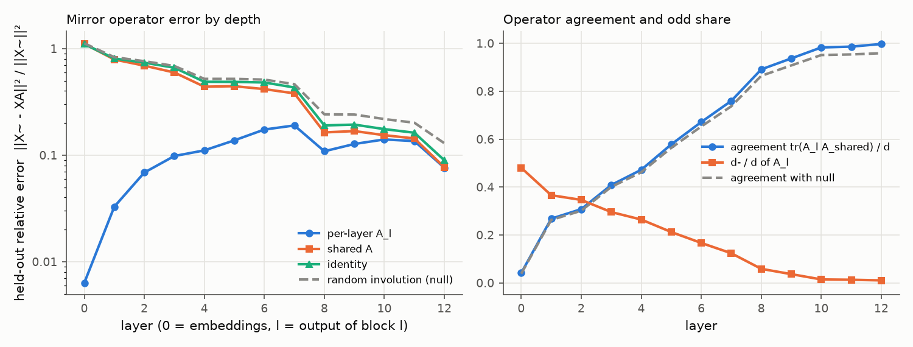
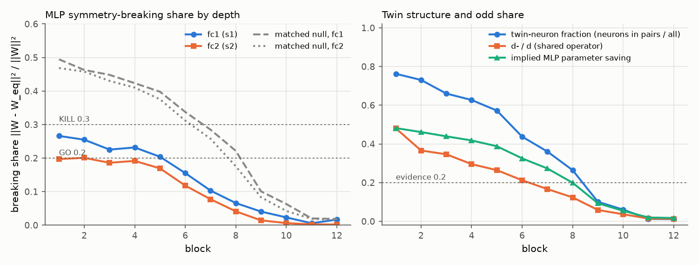

# E1 report: Mirror Surgery go/kill on dinov2_vitb14_reg

**Outcome: AMBER.** No rule fires: row(s) 4 not GO and no KILL cell in rows 1, 4, 5; needs a human decision.

## Run

- Date: 2026-11-08 12:47:37; git commit `94b2e19d8b902ca0ed6c65436d4155baa6fee8a3` (uncommitted changes present); seed 0.
- Config: `configs/x2_perlayer_reg.yaml`; device NVIDIA A100-SXM4-80GB; torch 2.11.0+cu128.
- Operator under test: one operator per layer (block b: fc1 against the operator of its input layer, fc2 against its output layer; nulls and SVD ranks matched per layer). Data split: cached order of appearance.
- Data: fit 2000, held-out 1000, k-NN bank 100000, queries 50000 images (each with its mirror); protocol v2: operators fitted on ImageNet train (fit seed 1), held-out errors and k-NN queries on validation, k-NN bank from train, k-NN features in bf16.
- Total time 21.6 min. Stages (s): load 3, sanity 1, fit_stats 36, fit_operators 292, heldout_errors 27, position_check 1, mlp_matching 317, breaking_share 2, surgery_knn 607.

## Decision table (blocks 1 to 6)

| Row | Check | Value | GO if | KILL if | Cell |
|---|---|---|---|---|---|
| 1 | e(null) / e(A_l (per layer)), mean over layers; worst layer 6: 5.73 | 13.07 | >= 5 | < 3 | **GO** |
| 2 | e(A_l (per layer)) / e(I), mean over layers; worst layer 6: 0.362 | 0.1698 | <= 0.5 | informative only | **GO** |
| 3 | d- / d (mean of per-layer A_l over layers 1 to 6) | 0.2752 | >= 0.2 | < 0.1: blocks GO, no KILL (PIVOT: little to save) | **GO** |
| 4 | MLP breaking share, max(mean s1, mean s2) [s1 0.223, s2 0.177; matched null s1 0.427, s2 0.409; twin fraction 0.632, d-/d 0.275] | 0.2229 | <= 0.2, and d-/d >= 0.2 or twin fraction >= 0.2 | > 0.3 | **AMBER** |
| 5 | Zero-shot surgery at k = 6: k-NN drop [original 78.94, surgery 77.09, SVD 8.78; margin over SVD 68.30] | 1.848 | drop <= 10 and margin >= 5 | no better than SVD (margin <= 0) | **GO** |

Per-layer values behind rows 1 and 2 (layer l is the output of block l). Worst layer: row 1 layer 6, row 2 layer 6.

| Layer | e(null) / e(A_l) | e(A_l) / e(I) |
|---|---|---|
| 1 | 50.88 | 0.04063 |
| 2 | 23.38 | 0.09299 |
| 3 | 14.83 | 0.1483 |
| 4 | 11.49 | 0.2271 |
| 5 | 8.219 | 0.2826 |
| 6 | 5.734 (worst) | 0.3616 (worst) |

How blocks are combined: rows 1 and 2 use the mean over layers 1 to 6 of the relative held-out error e / ||X~||², then the ratio of those means. Row 4 averages s1 and s2 over blocks 1 to 6 and uses the larger; a low share counts as evidence only if d-/d is at least 0.2 or the mean twin-neuron fraction is at least 0.2. Row 5 uses surgery on the first 6 blocks. Outcome, in order: KILL if any KILL cell in rows 1, 4 or 5; GO if all rows are GO; PIVOT: structure but little to save, if d-/d is below the row 3 KILL limit; PIVOT if rows 1 to 4 are GO and the drop is above the GO limit; otherwise AMBER (the table gives no verdict).

## Residual stream: one mirror operator?

Shared operator fitted on summed C over layers 1 to 12: d = 768, d+ = 760, d- = 8 (d-/d = 0.010). Directions with no signal (assigned +1): 1. Errors are relative, e / ||X~||², on held-out images; the null is a random orthogonal involution with the same d+ (mean of 3 seeds).

| layer | d- (A_l) | tr(A_l A)/d | e(A_l) | e(A) | e(A, scale-normalised fit) | e(I) | e(null) | e(null)/e(A) |
|---|---|---|---|---|---|---|---|---|
| 0 | 369 | 0.041 | 0.006328 | 1.109 | 0.6656 | 1.101 | 1.121 | 1.01 |
| 1 | 281 | 0.268 | 0.03282 | 0.7904 | 0.389 | 0.8078 | 0.8308 | 1.05 |
| 2 | 266 | 0.308 | 0.06864 | 0.6918 | 0.3171 | 0.7382 | 0.7615 | 1.1 |
| 3 | 227 | 0.408 | 0.09814 | 0.5967 | 0.278 | 0.6617 | 0.6872 | 1.15 |
| 4 | 203 | 0.472 | 0.1108 | 0.4391 | 0.2514 | 0.4881 | 0.52 | 1.18 |
| 5 | 163 | 0.578 | 0.1377 | 0.4437 | 0.2821 | 0.487 | 0.52 | 1.17 |
| 6 | 128 | 0.671 | 0.1739 | 0.4167 | 0.3034 | 0.4809 | 0.5115 | 1.23 |
| 7 | 95 | 0.760 | 0.19 | 0.3801 | 0.3112 | 0.4317 | 0.4638 | 1.22 |
| 8 | 45 | 0.891 | 0.1088 | 0.1634 | 0.1692 | 0.1901 | 0.2416 | 1.48 |
| 9 | 28 | 0.937 | 0.1273 | 0.1683 | 0.2045 | 0.1935 | 0.2405 | 1.43 |
| 10 | 11 | 0.983 | 0.1404 | 0.1539 | 0.2401 | 0.1755 | 0.2181 | 1.42 |
| 11 | 10 | 0.986 | 0.1355 | 0.1435 | 0.241 | 0.1624 | 0.2015 | 1.4 |
| 12 | 8 | 0.997 | 0.07617 | 0.07692 | 0.2216 | 0.08949 | 0.1294 | 1.68 |

## Position embedding

||mirror(P) - P A|| / ||P|| on the 16 x 16 patch grid (P channel-centred like the tokens; the second column also removes the mean over positions).

| Operator | channel-centred | also grid-centred |
|---|---|---|
| A_shared | 0.8446 | 0.8678 |
| A_0 (layer 0) | 0.2129 | 0.1852 |
| identity | 1.052 | 1.082 |
| null | 1.061 | 1.09 |

Layer 0 held-out error with the shared operator: e(A) = 1.109 (e(A_0) = 0.006328, e(I) = 1.101).

## MLP twins and breaking share

Neuron involution per block from the mirrored-versus-original fc1 correlations; breaking share of the folded weights against each block's input-layer operator (fc1) and output-layer operator (fc2). Matched null (mean of 3 seeds): a random involution with the same d+ and d- as each layer's operator and, per block, a random pairing with the same numbers of pairs and self-twins as the fitted one. d-/d is that of the block's input-layer operator. If the fitted structure is nearly trivial (few odd features, few pairs), the matched null is nearly trivial too and its share is also low; a low share then is not evidence. Twin fraction = neurons in pairs / all neurons. Evidence = d-/d at least 0.2 or twin fraction at least 0.2.

| block | pairs | self-twins | twin fraction | d-/d | mean corr (pairs) | mean corr (self) | s1 | s1 matched null | s2 | s2 matched null | evidence | implied saving | SVD rank |
|---|---|---|---|---|---|---|---|---|---|---|---|---|---|
| 1 | 1171 | 730 | 0.762 | 0.480 | 0.802 | 0.819 | 0.266 | 0.495 | 0.197 | 0.468 | yes | 0.482 | 310 |
| 2 | 1122 | 828 | 0.730 | 0.366 | 0.725 | 0.783 | 0.255 | 0.463 | 0.201 | 0.458 | yes | 0.461 | 329 |
| 3 | 1014 | 1044 | 0.660 | 0.346 | 0.684 | 0.804 | 0.225 | 0.448 | 0.186 | 0.430 | yes | 0.439 | 339 |
| 4 | 963 | 1146 | 0.627 | 0.296 | 0.634 | 0.790 | 0.232 | 0.423 | 0.192 | 0.410 | yes | 0.418 | 354 |
| 5 | 879 | 1314 | 0.572 | 0.264 | 0.623 | 0.802 | 0.204 | 0.398 | 0.169 | 0.375 | yes | 0.388 | 369 |
| 6 | 672 | 1728 | 0.438 | 0.212 | 0.662 | 0.858 | 0.155 | 0.338 | 0.118 | 0.312 | yes | 0.325 | 406 |
| 7 | 554 | 1964 | 0.361 | 0.167 | 0.702 | 0.899 | 0.103 | 0.285 | 0.077 | 0.258 | yes | 0.273 | 438 |
| 8 | 406 | 2260 | 0.264 | 0.124 | 0.769 | 0.928 | 0.066 | 0.221 | 0.041 | 0.176 | yes | 0.199 | 477 |
| 9 | 155 | 2762 | 0.101 | 0.059 | 0.791 | 0.930 | 0.041 | 0.101 | 0.014 | 0.083 | no | 0.093 | 551 |
| 10 | 93 | 2886 | 0.061 | 0.036 | 0.824 | 0.938 | 0.023 | 0.063 | 0.006 | 0.042 | no | 0.054 | 574 |
| 11 | 19 | 3034 | 0.012 | 0.014 | 0.834 | 0.928 | 0.006 | 0.020 | 0.002 | 0.019 | no | 0.020 | 601 |
| 12 | 17 | 3038 | 0.011 | 0.013 | 0.841 | 0.959 | 0.017 | 0.018 | 0.002 | 0.016 | no | 0.017 | 603 |

## Zero-shot surgery (k-NN, k = 20, T = 0.07)

Surgery replaces the MLPs of the first k blocks by their nearest mirror-equivariant weights. SVD keeps the same number of parameters as a rank-r factorisation. Random uses the null operator and pairing. Top-1 and flip consistency are in percent.

| k | variant | top-1 | drop (points) | flip consistency | MLP params kept (first k blocks) |
|---|---|---|---|---|---|
| 0 | original | 78.94 | 0.00 | 96.28 | 1.000 |
| 6 | surgery | 77.09 | 1.85 | 92.26 | 0.581 |
| 6 | svd | 8.78 | 70.15 | 42.49 | 0.580 |
| 6 | random | 4.03 | 74.91 | 16.08 | 0.581 |

## Sanity checks in this run

- Folding (block 0, one fit batch): max abs difference 1.67e-05.
- Identity surgery on all blocks (A = I, P = I), CLS features of one batch: max abs difference 3.09e-05.

All numbers come from `scripts/run_e1.py` with the config, seed and commit above; per-layer and per-block values are in `results/e1_layers.csv`, `results/e1_mlp.csv` and `results/e1_surgery.csv`.
